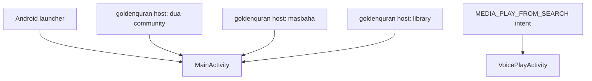

# Golden Quran — Master Markdown Export

## Master index

# Golden Quran Investigation — Master Index

## Status

This is a static review of the supplied base APK. It uses the existing Craft Anything investigation and its 123 evidence records. Static evidence does not prove runtime behavior. (Evidence: `ev_55cb1857387ddb7ebec559676ad1724de0f8dd23f12885df156be909cd84ec23`, `ev_e1da8b1964770471afaf2078706f7ab6c5392c4e03696fa13416257d25f9ac16`.)

## Target

- APK: `base.apk`
- Package: `org.goldenquran.freesoft`
- Version: `21.4`
- Target ID: `t_89de96aaf1e7`
- SHA-256: `89de96aaf1e71fe7d07e602bc6fc25606f23ae90d7946b4990fa0c438bc70f32`

(Evidence: `ev_55cb1857387ddb7ebec559676ad1724de0f8dd23f12885df156be909cd84ec23`.)

## Files in this export

- `MASTER_INDEX.md` — this guide.
- `MASTER_EXPORT.md` — complete combined report, including JSON-formatted inventories.
- `COMPLETE_FEATURE_INVENTORY.md` — feature evidence, status, behavior, dependencies, and unknowns.
- `SCREEN_CATALOG.md` — manifest activities and candidate screens.
- `ANDROID_ARCHITECTURE.md` — package structure, Android components, and library clues.
- `DATABASE_SCHEMA_REPORT.md` — bundled database names and schema gaps.
- `NAVIGATION_ANALYSIS.md` — observed entry points and unknown screen routes.
- `UI_RESOURCE_MAP.md` — archive/resource counts and locale coverage.
- `CLAUDE_IMPLEMENTATION_GUIDE.md` — planning notes only; no app development.
- `EVIDENCE_AND_COVERAGE.md` — evidence scope and six open questions.
- `modules.md` — module/package group summary.
- `features.json`, `screens.json`, and `modules.json` are not separate files. Their complete JSON text is included in `MASTER_EXPORT.md`, because Craft Anything's JSON writer only works during an app build. No build was started.

## Main observations

- The manifest lists 63 components: 15 activities, 21 services, 23 receivers, and four providers. Fourteen are reachable from outside the app. (Evidence: `ev_39750d92941a3a038f6c33eebb7f83ff2cabe3b7e295d68bce50c6589675a9cf`.)
- The APK contains 541 app-namespace classes in two DEX files. (Evidence: `ev_e1da8b1964770471afaf2078706f7ab6c5392c4e03696fa13416257d25f9ac16`.)
- The archive contains three database files by name: `quran_app.db`, `quran_glyphs.db`, and `athkar_duas.db`. Their schemas were not read. (Evidence: `ev_a515a1161c2ab139e888b0749cb24fb0bceef12319a40a2c2fecf7e0ac5e5708`; unknown `unk_85988a97c784b919`.)
- MainActivity is the launcher and accepts `dua-community`, `masbaha`, and `library` deep-link hosts. The destination screens are unknown. (Evidence: `ev_26731ad05568d33e2d46d39425c3f6e21343e27d1ff95f7a0a5fb3bba7874ebf`.)
- The saved default-locale string pages do not provide Arabic translations; no Arabic wording is guessed. (Evidence: `ev_68e06b198c904e77a5ba7ca123f5bad0926a019a2273044dcfcbc0b3617e5274`, `ev_3bc35bc101d739e5853efa813f0d6c4a250685918a8cd4ec19e03029503c4b54`.)

## Open questions

The six investigation unknowns cover the archive asset-count conflict, exact database schemas, screen paths, runtime availability/downloads, settings persistence, and split-package completeness. Their IDs and evidence are in `EVIDENCE_AND_COVERAGE.md`.


---

This report contains every documentation section requested, plus JSON-formatted feature, screen, and module inventories. The separate Markdown files listed here were read back after saving. Individual .json files could not be written because Craft Anything's JSON-capable writer only works while an app project is being built; no app build was started.

---

# Source section: COMPLETE_FEATURE_INVENTORY.md

# COMPLETE FEATURE INVENTORY

## Reading guide

“Observed” means a name, class, model, or Android component is directly present in saved static evidence. “Inferred” describes likely user behavior based on those clues. No feature in this inventory was confirmed by running the APK. For each item, dependencies are only listed when evidence supports them; otherwise they are marked unknown.

## Quran reading and browsing

- **Verification:** Strong static evidence; runtime behavior unverified.
- **Observed:** Quran reading and navigation labels appear in the saved default string pages. The app class roster includes Quran-related UI and data groups.
- **Behavior:** Inferred: the app likely lets a person browse Quran content by chapter, page, or verse. Exact gestures and reader layout are unknown.
- **Dependencies:** Quran-related bundled data is named in the archive. Reader UI and model classes are present.
- **Unknown:** Actual reader screen and navigation path. Whether all reading modes work in the supplied build. Exact Arabic screen labels were not captured in the saved default-locale pages.
- **Evidence:** `ev_68e06b198c904e77a5ba7ca123f5bad0926a019a2273044dcfcbc0b3617e5274`, `ev_65c3b2089d5998b75b20f115d94412b2f641834090f4cc03f867c6b1cbbc762d`, `ev_61673d9c6428891a4d336fb7206fb0ad39da0fb678bf1c43fa858539dfd026ef`, `ev_b97caf2a9f49d85f6ce467f57f483d268d10b9b3fe7d137bfb270099830bf805`, `ev_32944f8a6a36bf3f3eb20651131c7365b09f929052a59d57731ec287712a12f8`, `ev_e1da8b1964770471afaf2078706f7ab6c5392c4e03696fa13416257d25f9ac16`, `ev_a515a1161c2ab139e888b0749cb24fb0bceef12319a40a2c2fecf7e0ac5e5708`, `ev_a515a1161c2ab139e888b0749cb24fb0bceef12319a40a2c2fecf7e0ac5e5708`, `ev_97394cff8bbfe06329439c2496576fca3732a967b2fafa88d59cceb6f2e0e36c`, `ev_da0f10e0c54356306c1de1e68d24503382352e033afd096e2d5b810e3cc4cc11`, `ev_4abac963d58f8fa70214549776d798933d1de95a8bba41fe5369c8f1262b9db3`, `ev_81bdafc400a10a130f43cac89b48072c15095673e0ebfc2e10fbf740e659d02b`, `ev_988da5bf451618fdb79677f2aaa5b047f1d310da713471b1fce45c062e4afa00`

## Mushaf copies and reader preferences

- **Verification:** Static model and resource evidence; runtime unverified.
- **Observed:** The saved class evidence includes UserMushaf, and the resource strings name Quran copies.
- **Behavior:** Inferred: a person may select or configure a Quran copy or reading style.
- **Dependencies:** UserMushaf data model. Quran reader and content.
- **Unknown:** What each copy changes. Where the selection is saved. Whether copy assets are in this base APK or a split.
- **Evidence:** `ev_491981fd821bd23cbd10b961634230250467e4be4f32274100698e31ed994143`, `ev_68e06b198c904e77a5ba7ca123f5bad0926a019a2273044dcfcbc0b3617e5274`, `ev_65c3b2089d5998b75b20f115d94412b2f641834090f4cc03f867c6b1cbbc762d`, `ev_e1da8b1964770471afaf2078706f7ab6c5392c4e03696fa13416257d25f9ac16`

## Quran and content search

- **Verification:** Observed model and label evidence; search runtime unverified.
- **Observed:** SearchObject fields include text/hit data and optional page, ayah, surah, reciter, and book IDs; result types include ayah, glossary, note, page, subject, surah, Tafsir, and translation.
- **Behavior:** Inferred: search may cover Quran text and related library/audio content, with results that can refer to a page or verse.
- **Dependencies:** SearchObject/result models. Quran, Tafsir/translation, audio, and library data as available.
- **Unknown:** Matching method, ranking, filters, and empty/error states. Whether search is local, server-backed, or mixed.
- **Evidence:** `ev_80abce67c3995730a6e7f50f3c604b87bf3b3680ce136b2df26a15c3d151949c`, `ev_4ccbcdca4f775a5da9139ee11d4bbf84a67fc4f8ab9a559494f488c1947a4d0f`, `ev_61673d9c6428891a4d336fb7206fb0ad39da0fb678bf1c43fa858539dfd026ef`, `ev_5759bc1ed62ad5ea63e8dc5ecc327a048c3dfc94bd86ab592c25389371e3bb83`

## Bookmarks and notes

- **Verification:** Observed labels and local model evidence; save behavior unverified.
- **Observed:** The resource pages name bookmark actions, and the saved model inventory includes local bookmark and note-related data.
- **Behavior:** Inferred: readers can mark a place and attach or review notes.
- **Dependencies:** Quran reader. Local bookmark/note models; storage target is unknown.
- **Unknown:** Fields stored, save timing, sync, and deletion behavior. Exact bookmark and note screens.
- **Evidence:** `ev_491981fd821bd23cbd10b961634230250467e4be4f32274100698e31ed994143`, `ev_491981fd821bd23cbd10b961634230250467e4be4f32274100698e31ed994143`, `ev_8d8a994d7236b381f49b17d4dc5fcb5877e99aaa726a4641ea9bbcd99e3e5d37`, `ev_68e06b198c904e77a5ba7ca123f5bad0926a019a2273044dcfcbc0b3617e5274`, `ev_65c3b2089d5998b75b20f115d94412b2f641834090f4cc03f867c6b1cbbc762d`, `ev_61673d9c6428891a4d336fb7206fb0ad39da0fb678bf1c43fa858539dfd026ef`

## Tafsir and translation

- **Verification:** Observed named strings and search result types; runtime unverified.
- **Observed:** Default strings name Tafsir/translation and search result models include both result kinds.
- **Behavior:** Inferred: the app can present Quran explanation or translation content.
- **Dependencies:** Quran reader and related content data.
- **Unknown:** Available languages, providers, licensing, selection flow, and offline behavior.
- **Evidence:** `ev_80abce67c3995730a6e7f50f3c604b87bf3b3680ce136b2df26a15c3d151949c`, `ev_61673d9c6428891a4d336fb7206fb0ad39da0fb678bf1c43fa858539dfd026ef`, `ev_b97caf2a9f49d85f6ce467f57f483d268d10b9b3fe7d137bfb270099830bf805`, `ev_32944f8a6a36bf3f3eb20651131c7365b09f929052a59d57731ec287712a12f8`, `ev_5759bc1ed62ad5ea63e8dc5ecc327a048c3dfc94bd86ab592c25389371e3bb83`, `ev_db6aff248d905d610f5e67810ae753c054ff2130db7ff4538e40b132d1a7ee1b`

## Audio player and reciter library

- **Verification:** Observed Android service/model evidence; exact playback flow unverified.
- **Observed:** An app-owned AndroidX Media3 MediaSessionService exposes an ExoPlayer. AudioFragment and reciter, track, and playlist models are present.
- **Behavior:** Inferred: the app can browse reciters/tracks and play audio through an Android media session.
- **Dependencies:** AndroidX Media3 / ExoPlayer. Audio service and reciter/track/playlist data.
- **Unknown:** Queue rules, repeat/shuffle behavior, playback UI, and background controls in use.
- **Evidence:** `ev_536f67508c97bec7d34c3332a624f83165e79d534a49b466ab23cd65160be17e`, `ev_f822c9bd459082139b5dd08aadbddb2d832cd29642d7a23d909e777a8d646306`, `ev_e893c2122df0068c37143caf3405b556855171709cd70014179df7c1ba90fcfa`, `ev_9949e162820c1752548663f20a86c9033660ccfd252cbbeebc0e54ceac8821c0`, `ev_00df656201863ae3774492f0d23d6cbbeda861dc4a5a39a2c351f51f78d46076`, `ev_bfb102ffeba3ec807d12d8a6a187897fac4ec3f9de49de5bb08cbff8313593a0`, `ev_68e06b198c904e77a5ba7ca123f5bad0926a019a2273044dcfcbc0b3617e5274`, `ev_65c3b2089d5998b75b20f115d94412b2f641834090f4cc03f867c6b1cbbc762d`, `ev_61673d9c6428891a4d336fb7206fb0ad39da0fb678bf1c43fa858539dfd026ef`, `ev_b97caf2a9f49d85f6ce467f57f483d268d10b9b3fe7d137bfb270099830bf805`

## Audio downloads and offline audio

- **Verification:** Static worker, model, and string evidence; offline playback unverified.
- **Observed:** Audio download labels and audio refresh/update workers and download-state models are present.
- **Behavior:** Inferred: audio files or metadata may be downloaded for offline use.
- **Dependencies:** Audio library. Download worker and local file/storage handling.
- **Unknown:** File locations, download triggers, cancellation/retry, storage permission behavior, and offline playback.
- **Evidence:** `ev_536f67508c97bec7d34c3332a624f83165e79d534a49b466ab23cd65160be17e`, `ev_f822c9bd459082139b5dd08aadbddb2d832cd29642d7a23d909e777a8d646306`, `ev_e893c2122df0068c37143caf3405b556855171709cd70014179df7c1ba90fcfa`, `ev_9949e162820c1752548663f20a86c9033660ccfd252cbbeebc0e54ceac8821c0`, `ev_00df656201863ae3774492f0d23d6cbbeda861dc4a5a39a2c351f51f78d46076`, `ev_bfb102ffeba3ec807d12d8a6a187897fac4ec3f9de49de5bb08cbff8313593a0`, `ev_21fa2807dc0b248148037806d6ea6f15c7f0f3654447f8a306499eb236d4a376`, `ev_29d50bdab145fdc49594017f31026c7ac8b93fbb769b6306a613f707685b1883`

## Prayer times and prayer check-ins

- **Verification:** Static labels, model, and background component evidence; runtime unverified.
- **Observed:** Prayer-time labels and a PrayerCheckin model are recorded. Prayer-related services, receivers, and workers are listed.
- **Behavior:** Inferred: the app may display prayer times and record prayer completion/check-ins.
- **Dependencies:** Location/time-related Android permissions are declared. Prayer models and background components.
- **Unknown:** Calculation method, location source, timezone handling, and check-in persistence.
- **Evidence:** `ev_9949e162820c1752548663f20a86c9033660ccfd252cbbeebc0e54ceac8821c0`, `ev_9110bed55a2cfa96177f886cfce173b8f0de9b97c9897ff4221e58cba3a8c002`, `ev_391dfd2a90e6006f0d95dbff5e7151df31a77cc3d9893f34115308a301952505`, `ev_d98e00581bef96d3db871ebafbcb70e17c17835eb6cefddaf11b1144b131f1e6`, `ev_67d05f730f699fcb51e734a5f60fbe3c785f1cb301f11904e40afc48ec2c96bb`, `ev_2e97d4b9df5dbfd63432f9379d76e16a480beac7ac615002c0b9febf1a6e27cd`, `ev_7b95177c7ec0b99ec1febe3c990ff41799b127e5777a967b8fc58ea04af2b2d4`, `ev_61673d9c6428891a4d336fb7206fb0ad39da0fb678bf1c43fa858539dfd026ef`, `ev_b97caf2a9f49d85f6ce467f57f483d268d10b9b3fe7d137bfb270099830bf805`, `ev_32944f8a6a36bf3f3eb20651131c7365b09f929052a59d57731ec287712a12f8`, `ev_5759bc1ed62ad5ea63e8dc5ecc327a048c3dfc94bd86ab592c25389371e3bb83`, `ev_db6aff248d905d610f5e67810ae753c054ff2130db7ff4538e40b132d1a7ee1b`

## Prayer alarms and home-screen widgets

- **Verification:** Observed manifest/resource configuration; actual scheduling unverified.
- **Observed:** The manifest declares prayer alarm services/receivers and three widgets. Two prayer widget provider definitions specify a 15-minute update interval. Prayer alarm service fields include MediaPlayer, AudioManager, WakeLock, Handler, and HandlerThread.
- **Behavior:** Inferred: scheduled alarms can play audio and widgets can refresh prayer information.
- **Dependencies:** Android alarm/background scheduling. Audio playback components. Widget providers.
- **Unknown:** Whether alarms are scheduled in normal use, exact alarm rules, content, and widget appearance.
- **Evidence:** `ev_9949e162820c1752548663f20a86c9033660ccfd252cbbeebc0e54ceac8821c0`, `ev_9110bed55a2cfa96177f886cfce173b8f0de9b97c9897ff4221e58cba3a8c002`, `ev_391dfd2a90e6006f0d95dbff5e7151df31a77cc3d9893f34115308a301952505`, `ev_d98e00581bef96d3db871ebafbcb70e17c17835eb6cefddaf11b1144b131f1e6`, `ev_67d05f730f699fcb51e734a5f60fbe3c785f1cb301f11904e40afc48ec2c96bb`, `ev_2e97d4b9df5dbfd63432f9379d76e16a480beac7ac615002c0b9febf1a6e27cd`, `ev_10b1f848f3fa28997f3dd4ee9275b57a8047c50ac2b13ae0a7eec4b7db5413c1`

## Qibla direction

- **Verification:** Named static feature evidence; behavior and runtime unverified.
- **Observed:** Qibla appears among the recorded user-facing feature strings and app class areas.
- **Behavior:** Inferred: the feature may show a direction toward the Qibla.
- **Dependencies:** Likely device location or orientation sensors; actual code dependency was not established.
- **Unknown:** Sensor use, calculation source, calibration steps, and screen layout.
- **Evidence:** `ev_b97caf2a9f49d85f6ce467f57f483d268d10b9b3fe7d137bfb270099830bf805`, `ev_32944f8a6a36bf3f3eb20651131c7365b09f929052a59d57731ec287712a12f8`, `ev_5759bc1ed62ad5ea63e8dc5ecc327a048c3dfc94bd86ab592c25389371e3bb83`, `ev_db6aff248d905d610f5e67810ae753c054ff2130db7ff4538e40b132d1a7ee1b`, `ev_e1da8b1964770471afaf2078706f7ab6c5392c4e03696fa13416257d25f9ac16`, `ev_05c1f6c2ab3547ccce70c095559a6ad9ec9054f4f4217b7b273a5981faa12128`

## Athkar and duas

- **Verification:** Observed feature strings and bundled database name; runtime unverified.
- **Observed:** Strings name athkar and duas, and the APK contains athkar_duas.db.
- **Behavior:** Inferred: the app can present devotional text and may track completion.
- **Dependencies:** athkar_duas.db by filename. AthkarCompletion model.
- **Unknown:** Actual schema, categories, source, completion rules, and offline behavior.
- **Evidence:** `ev_a515a1161c2ab139e888b0749cb24fb0bceef12319a40a2c2fecf7e0ac5e5708`, `ev_a515a1161c2ab139e888b0749cb24fb0bceef12319a40a2c2fecf7e0ac5e5708`, `ev_97394cff8bbfe06329439c2496576fca3732a967b2fafa88d59cceb6f2e0e36c`, `ev_da0f10e0c54356306c1de1e68d24503382352e033afd096e2d5b810e3cc4cc11`, `ev_4abac963d58f8fa70214549776d798933d1de95a8bba41fe5369c8f1262b9db3`, `ev_81bdafc400a10a130f43cac89b48072c15095673e0ebfc2e10fbf740e659d02b`, `ev_988da5bf451618fdb79677f2aaa5b047f1d310da713471b1fce45c062e4afa00`, `ev_68e06b198c904e77a5ba7ca123f5bad0926a019a2273044dcfcbc0b3617e5274`, `ev_65c3b2089d5998b75b20f115d94412b2f641834090f4cc03f867c6b1cbbc762d`, `ev_61673d9c6428891a4d336fb7206fb0ad39da0fb678bf1c43fa858539dfd026ef`, `ev_b97caf2a9f49d85f6ce467f57f483d268d10b9b3fe7d137bfb270099830bf805`, `ev_32944f8a6a36bf3f3eb20651131c7365b09f929052a59d57731ec287712a12f8`, `ev_f138cd73199c9cc4bb6ad2dcfae17d0ba8077255a109d0b8fb29818a8b896e5e`

## Dua Community

- **Verification:** Observed named string and deep-link host; destination behavior unverified.
- **Observed:** The manifest accepts the goldenquran dua-community host and strings name Dua Community.
- **Behavior:** The deep-link host is observed. What the community page displays or lets a user do is unknown.
- **Dependencies:** MainActivity deep-link handling. Network/account dependencies are not established.
- **Unknown:** Destination screen, sign-in rules, posts, moderation, and server APIs.
- **Evidence:** `ev_26731ad05568d33e2d46d39425c3f6e21343e27d1ff95f7a0a5fb3bba7874ebf`, `ev_24b65ad3b0aa13e4630a7dfd206de7d2d9c4725b60caad9c37b1c15d334ab9f5`, `ev_68e06b198c904e77a5ba7ca123f5bad0926a019a2273044dcfcbc0b3617e5274`, `ev_65c3b2089d5998b75b20f115d94412b2f641834090f4cc03f867c6b1cbbc762d`, `ev_61673d9c6428891a4d336fb7206fb0ad39da0fb678bf1c43fa858539dfd026ef`

## Masbaha counter

- **Verification:** Observed deep-link host and feature name; counting behavior inferred.
- **Observed:** The manifest accepts a masbaha deep-link host; masbaha is named in feature resources/class inventory.
- **Behavior:** Inferred: a counter may record repeated recitations.
- **Dependencies:** MainActivity deep-link handling. Persistence is unknown.
- **Unknown:** Counter controls, reset behavior, saved history, and exact screen.
- **Evidence:** `ev_26731ad05568d33e2d46d39425c3f6e21343e27d1ff95f7a0a5fb3bba7874ebf`, `ev_24b65ad3b0aa13e4630a7dfd206de7d2d9c4725b60caad9c37b1c15d334ab9f5`, `ev_b97caf2a9f49d85f6ce467f57f483d268d10b9b3fe7d137bfb270099830bf805`, `ev_32944f8a6a36bf3f3eb20651131c7365b09f929052a59d57731ec287712a12f8`, `ev_5759bc1ed62ad5ea63e8dc5ecc327a048c3dfc94bd86ab592c25389371e3bb83`, `ev_db6aff248d905d610f5e67810ae753c054ff2130db7ff4538e40b132d1a7ee1b`, `ev_e1da8b1964770471afaf2078706f7ab6c5392c4e03696fa13416257d25f9ac16`

## Khetma reading plan

- **Verification:** Observed model and named strings; progress behavior inferred.
- **Observed:** A Khetma model and Khetma-related strings are present.
- **Behavior:** Inferred: a reading plan may track progress toward completing the Quran.
- **Dependencies:** Khetma model. Quran chapter/page data.
- **Unknown:** Plan creation, schedule, reminders, progress updates, and storage.
- **Evidence:** `ev_2192a005abb265111e3eb899a09ad94cd2780c8a707400201289acfa6486cf6f`, `ev_32944f8a6a36bf3f3eb20651131c7365b09f929052a59d57731ec287712a12f8`, `e`, `v`, `_`, `e`, `1`, `d`, `a`, `8`, `b`, `1`, `9`, `6`, `4`, `7`, `7`, `0`, `4`, `7`, `1`, `a`, `f`, `a`, `f`, `2`, `0`, `7`, `8`, `7`, `0`, `6`, `f`, `7`, `a`, `b`, `6`, `c`, `5`, `3`, `9`, `2`, `c`, `4`, `e`, `0`, `3`, `6`, `9`, `6`, `f`, `a`, `1`, `3`, `4`, `1`, `6`, `2`, `5`, `7`, `d`, `2`, `5`, `f`, `9`, `a`, `c`, `1`, `6`

## Tasmee recitation practice

- **Verification:** Inferred from model, fragment, workers, and labels; runtime unverified.
- **Observed:** TasmeeFragment and TasmeeSession models are recorded. Evidence names fields for chapter/range, duration, correct/missed/wrong words, hints, and score; strings describe a one-time model download for offline use and a score-upload worker.
- **Behavior:** Inferred: a person practices reciting a selected Quran range and receives recognition feedback and a score.
- **Dependencies:** Quran text/range selection. Recognition model download. Score upload worker.
- **Unknown:** Recognition accuracy, exact voice flow, offline operation, upload conditions, and whether the feature runs.
- **Evidence:** `ev_8d8a994d7236b381f49b17d4dc5fcb5877e99aaa726a4641ea9bbcd99e3e5d37`, `ev_3813fe3b4d09b4a8152d71561278fd9bc4b8c993eb02447f2d4649890f8f94cc`, `ev_61673d9c6428891a4d336fb7206fb0ad39da0fb678bf1c43fa858539dfd026ef`, `ev_b97caf2a9f49d85f6ce467f57f483d268d10b9b3fe7d137bfb270099830bf805`, `ev_32944f8a6a36bf3f3eb20651131c7365b09f929052a59d57731ec287712a12f8`, `ev_5759bc1ed62ad5ea63e8dc5ecc327a048c3dfc94bd86ab592c25389371e3bb83`, `ev_db6aff248d905d610f5e67810ae753c054ff2130db7ff4538e40b132d1a7ee1b`, `ev_e1da8b1964770471afaf2078706f7ab6c5392c4e03696fa13416257d25f9ac16`

## Hadith collection

- **Verification:** Observed named content and search terms; runtime unverified.
- **Observed:** Strings name An-Nawawi's Forty Hadith and hadith search.
- **Behavior:** Inferred: a person can browse or search a hadith collection.
- **Dependencies:** Book/library content and search models.
- **Unknown:** Full collection, source, translations, and screen path.
- **Evidence:** `ev_68e06b198c904e77a5ba7ca123f5bad0926a019a2273044dcfcbc0b3617e5274`, `ev_65c3b2089d5998b75b20f115d94412b2f641834090f4cc03f867c6b1cbbc762d`, `ev_61673d9c6428891a4d336fb7206fb0ad39da0fb678bf1c43fa858539dfd026ef`, `ev_b97caf2a9f49d85f6ce467f57f483d268d10b9b3fe7d137bfb270099830bf805`, `ev_32944f8a6a36bf3f3eb20651131c7365b09f929052a59d57731ec287712a12f8`, `ev_5759bc1ed62ad5ea63e8dc5ecc327a048c3dfc94bd86ab592c25389371e3bb83`, `ev_db6aff248d905d610f5e67810ae753c054ff2130db7ff4538e40b132d1a7ee1b`, `ev_80abce67c3995730a6e7f50f3c604b87bf3b3680ce136b2df26a15c3d151949c`, `ev_4ccbcdca4f775a5da9139ee11d4bbf84a67fc4f8ab9a559494f488c1947a4d0f`

## Books and library reader

- **Verification:** Observed library reader class and deep-link host; screen contents partly unknown.
- **Observed:** LibraryReaderFragment is present. MainActivity accepts the library deep-link host; book search labels are recorded.
- **Behavior:** Inferred: the app includes a book/library browsing and reading area.
- **Dependencies:** LibraryReaderFragment. Book data and search models.
- **Unknown:** Book list, downloads, reader layout, and exact deep-link destination.
- **Evidence:** `ev_8b02d869709d2d76e099527c445e48fb81f43e3cc3d6f5c26442f82d84724b5e`, `ev_26731ad05568d33e2d46d39425c3f6e21343e27d1ff95f7a0a5fb3bba7874ebf`, `ev_24b65ad3b0aa13e4630a7dfd206de7d2d9c4725b60caad9c37b1c15d334ab9f5`, `ev_80abce67c3995730a6e7f50f3c604b87bf3b3680ce136b2df26a15c3d151949c`, `ev_4ccbcdca4f775a5da9139ee11d4bbf84a67fc4f8ab9a559494f488c1947a4d0f`, `ev_61673d9c6428891a4d336fb7206fb0ad39da0fb678bf1c43fa858539dfd026ef`, `ev_b97caf2a9f49d85f6ce467f57f483d268d10b9b3fe7d137bfb270099830bf805`, `ev_32944f8a6a36bf3f3eb20651131c7365b09f929052a59d57731ec287712a12f8`, `ev_5759bc1ed62ad5ea63e8dc5ecc327a048c3dfc94bd86ab592c25389371e3bb83`, `ev_db6aff248d905d610f5e67810ae753c054ff2130db7ff4538e40b132d1a7ee1b`

## Live sessions and calls

- **Verification:** Observed strings and manifest components; runtime unverified.
- **Observed:** Live-session strings and live-call/messaging components are recorded.
- **Behavior:** Inferred: live or interactive session screens may be available.
- **Dependencies:** Manifest services/receivers; network and audio permissions are declared.
- **Unknown:** Whether sessions are video/audio/text, signaling provider, access rules, and runtime availability.
- **Evidence:** `ev_9949e162820c1752548663f20a86c9033660ccfd252cbbeebc0e54ceac8821c0`, `ev_9110bed55a2cfa96177f886cfce173b8f0de9b97c9897ff4221e58cba3a8c002`, `ev_391dfd2a90e6006f0d95dbff5e7151df31a77cc3d9893f34115308a301952505`, `ev_d98e00581bef96d3db871ebafbcb70e17c17835eb6cefddaf11b1144b131f1e6`, `ev_67d05f730f699fcb51e734a5f60fbe3c785f1cb301f11904e40afc48ec2c96bb`, `ev_2e97d4b9df5dbfd63432f9379d76e16a480beac7ac615002c0b9febf1a6e27cd`, `ev_32944f8a6a36bf3f3eb20651131c7365b09f929052a59d57731ec287712a12f8`, `ev_5759bc1ed62ad5ea63e8dc5ecc327a048c3dfc94bd86ab592c25389371e3bb83`, `ev_db6aff248d905d610f5e67810ae753c054ff2130db7ff4538e40b132d1a7ee1b`, `ev_55cb1857387ddb7ebec559676ad1724de0f8dd23f12885df156be909cd84ec23`

## Worship tracking and statistics

- **Verification:** Observed local models; displayed behavior inferred.
- **Observed:** Statistics, AthkarCompletion, and PrayerCheckin models are present.
- **Behavior:** Inferred: the app may summarize reading or worship activity.
- **Dependencies:** Local tracking models. Storage and sync destination unknown.
- **Unknown:** Metric definitions, aggregation windows, charts, and persistence.
- **Evidence:** `ev_491981fd821bd23cbd10b961634230250467e4be4f32274100698e31ed994143`, `ev_8d8a994d7236b381f49b17d4dc5fcb5877e99aaa726a4641ea9bbcd99e3e5d37`, `ev_3813fe3b4d09b4a8152d71561278fd9bc4b8c993eb02447f2d4649890f8f94cc`, `ev_2192a005abb265111e3eb899a09ad94cd2780c8a707400201289acfa6486cf6f`, `ev_3ac55afecc178890337f7a9cf6e6b8d38f01b56a287db9a62e0587aadb128c7e`, `ev_9291c81216a31a8e58df7ca71a13409a3c8f0c163e7e70ff6f21c6c8a36208c4`, `ev_f138cd73199c9cc4bb6ad2dcfae17d0ba8077255a109d0b8fb29818a8b896e5e`, `ev_7b95177c7ec0b99ec1febe3c990ff41799b127e5777a967b8fc58ea04af2b2d4`

## Islamic events, zakat, and related tools

- **Verification:** Class-name evidence only; behavior and availability unverified.
- **Observed:** The 541-class inventory names event, zakat, and related tool areas.
- **Behavior:** Only feature-area names are known; no workflow is established.
- **Dependencies:** Specific service or data dependencies are unknown.
- **Unknown:** Screens, calculations, data source, localization, and enabled status.
- **Evidence:** `ev_e1da8b1964770471afaf2078706f7ab6c5392c4e03696fa13416257d25f9ac16`, `ev_05c1f6c2ab3547ccce70c095559a6ad9ec9054f4f4217b7b273a5981faa12128`

## Sync, notifications, and reminders

- **Verification:** Observed workers and receivers; actual scheduling and network behavior unverified.
- **Observed:** Sync workers, messaging components, reminder jobs, and notification-related permissions are declared.
- **Behavior:** Inferred: background jobs may sync account/reading data and trigger reminders or notifications.
- **Dependencies:** WorkManager, Firebase Messaging, Android notification/alarm services.
- **Unknown:** What is synced, server API, when work is scheduled, retry rules, notification contents, and runtime permission flow.
- **Evidence:** `ev_55cb1857387ddb7ebec559676ad1724de0f8dd23f12885df156be909cd84ec23`, `ev_9925014e76a9d8f343e69e6a9f7a5fff65dbc154f32020f68420dda08617630f`, `ev_f00468268997427851cfe570700502c3b25b4cf102db552435f4676cc03d3541`, `ev_9949e162820c1752548663f20a86c9033660ccfd252cbbeebc0e54ceac8821c0`, `ev_9110bed55a2cfa96177f886cfce173b8f0de9b97c9897ff4221e58cba3a8c002`, `ev_391dfd2a90e6006f0d95dbff5e7151df31a77cc3d9893f34115308a301952505`, `ev_d98e00581bef96d3db871ebafbcb70e17c17835eb6cefddaf11b1144b131f1e6`, `ev_67d05f730f699fcb51e734a5f60fbe3c785f1cb301f11904e40afc48ec2c96bb`, `ev_2e97d4b9df5dbfd63432f9379d76e16a480beac7ac615002c0b9febf1a6e27cd`

## Settings and saved reader state

- **Verification:** Observed models; storage and save behavior unknown.
- **Observed:** Reader preference/page-position and user Mushaf models are recorded. Settings-related classes appear in the saved class evidence.
- **Behavior:** Inferred: the app may remember reading position and display preferences.
- **Dependencies:** UserMushaf and reader models. Storage and sync services are not mapped.
- **Unknown:** Exact preference keys, storage mechanism, save timing, reset behavior, and sync.
- **Evidence:** `ev_491981fd821bd23cbd10b961634230250467e4be4f32274100698e31ed994143`, `ev_8d8a994d7236b381f49b17d4dc5fcb5877e99aaa726a4641ea9bbcd99e3e5d37`, `ev_3813fe3b4d09b4a8152d71561278fd9bc4b8c993eb02447f2d4649890f8f94cc`, `ev_2192a005abb265111e3eb899a09ad94cd2780c8a707400201289acfa6486cf6f`, `ev_3ac55afecc178890337f7a9cf6e6b8d38f01b56a287db9a62e0587aadb128c7e`, `ev_9291c81216a31a8e58df7ca71a13409a3c8f0c163e7e70ff6f21c6c8a36208c4`, `ev_92f844f1aa4d89b49815c5ed4eff8552e267e94515a550e99f7b4e39376cbc6c`, `ev_e1da8b1964770471afaf2078706f7ab6c5392c4e03696fa13416257d25f9ac16`


## Arabic labels

The cited string records are default-locale pages. The resource-table summary reports 87 locales, but no Arabic translation rows were included in the cited default pages. This inventory does not invent Arabic translations. Exact Arabic labels remain unknown until Arabic-locale values are read from evidence. (Evidence: `ev_68e06b198c904e77a5ba7ca123f5bad0926a019a2273044dcfcbc0b3617e5274`, `ev_65c3b2089d5998b75b20f115d94412b2f641834090f4cc03f867c6b1cbbc762d`, `ev_61673d9c6428891a4d336fb7206fb0ad39da0fb678bf1c43fa858539dfd026ef`, `ev_3bc35bc101d739e5853efa813f0d6c4a250685918a8cd4ec19e03029503c4b54`.)


---

# Source section: SCREEN_CATALOG.md

# SCREEN CATALOG

## Status

The manifest confirms two app-owned external entry activities. The remaining items below are candidate screens inferred from class names, data models, or resource labels. Static records do not show that a candidate screen was opened or that its layout is active. (Evidence: `ev_24b65ad3b0aa13e4630a7dfd206de7d2d9c4725b60caad9c37b1c15d334ab9f5`, `ev_e1da8b1964770471afaf2078706f7ab6c5392c4e03696fa13416257d25f9ac16`, `ev_68e06b198c904e77a5ba7ca123f5bad0926a019a2273044dcfcbc0b3617e5274`–`ev_db6aff248d905d610f5e67810ae753c054ff2130db7ff4538e40b132d1a7ee1b`.)

## Catalog

### Main activity / app entry

- **Arabic label:** Not present in the saved default-locale evidence; do not guess.
- **Verification:** Manifest entry observed; destination screens not observed.
- **Behavior:** MainActivity is the launcher and accepts goldenquran deep-link hosts dua-community, masbaha, and library.
- **Dependencies:** Android activity and intent handling.
- **Unknown:** Home layout, tab/menu labels, and destination for each deep link.
- **Evidence:** `ev_26731ad05568d33e2d46d39425c3f6e21343e27d1ff95f7a0a5fb3bba7874ebf`, `ev_24b65ad3b0aa13e4630a7dfd206de7d2d9c4725b60caad9c37b1c15d334ab9f5`

### Voice/media search entry

- **Arabic label:** Not present in the saved default-locale evidence; do not guess.
- **Verification:** Manifest entry observed; runtime behavior untested.
- **Behavior:** VoicePlayActivity accepts MEDIA_PLAY_FROM_SEARCH.
- **Dependencies:** Android media-search intent handling. Media3 player is present.
- **Unknown:** How query text maps to a reciter, track, or queue.
- **Evidence:** `ev_26731ad05568d33e2d46d39425c3f6e21343e27d1ff95f7a0a5fb3bba7874ebf`, `ev_24b65ad3b0aa13e4630a7dfd206de7d2d9c4725b60caad9c37b1c15d334ab9f5`, `ev_536f67508c97bec7d34c3332a624f83165e79d534a49b466ab23cd65160be17e`, `ev_f822c9bd459082139b5dd08aadbddb2d832cd29642d7a23d909e777a8d646306`, `ev_e893c2122df0068c37143caf3405b556855171709cd70014179df7c1ba90fcfa`, `ev_9949e162820c1752548663f20a86c9033660ccfd252cbbeebc0e54ceac8821c0`, `ev_00df656201863ae3774492f0d23d6cbbeda861dc4a5a39a2c351f51f78d46076`, `ev_bfb102ffeba3ec807d12d8a6a187897fac4ec3f9de49de5bb08cbff8313593a0`

### Quran index

- **Arabic label:** Not present in the saved default-locale evidence; do not guess.
- **Verification:** Candidate screen; path and layout unverified.
- **Behavior:** Quran chapter/surah/page/verse navigation is suggested by resources and data models.
- **Dependencies:** Quran data and reader UI.
- **Unknown:** Visible layout, filters, ordering, and navigation transitions.
- **Evidence:** `ev_68e06b198c904e77a5ba7ca123f5bad0926a019a2273044dcfcbc0b3617e5274`, `ev_65c3b2089d5998b75b20f115d94412b2f641834090f4cc03f867c6b1cbbc762d`, `ev_61673d9c6428891a4d336fb7206fb0ad39da0fb678bf1c43fa858539dfd026ef`, `ev_b97caf2a9f49d85f6ce467f57f483d268d10b9b3fe7d137bfb270099830bf805`, `ev_a515a1161c2ab139e888b0749cb24fb0bceef12319a40a2c2fecf7e0ac5e5708`, `ev_97394cff8bbfe06329439c2496576fca3732a967b2fafa88d59cceb6f2e0e36c`, `ev_da0f10e0c54356306c1de1e68d24503382352e033afd096e2d5b810e3cc4cc11`, `ev_4abac963d58f8fa70214549776d798933d1de95a8bba41fe5369c8f1262b9db3`, `ev_81bdafc400a10a130f43cac89b48072c15095673e0ebfc2e10fbf740e659d02b`, `ev_988da5bf451618fdb79677f2aaa5b047f1d310da713471b1fce45c062e4afa00`, `ev_e1da8b1964770471afaf2078706f7ab6c5392c4e03696fa13416257d25f9ac16`

### Quran reader

- **Arabic label:** Not present in the saved default-locale evidence; do not guess.
- **Verification:** Candidate screen; runtime not observed.
- **Behavior:** Quran reading labels and reader data models point to a reading screen.
- **Dependencies:** Quran text/glyph data and reader UI.
- **Unknown:** Layout, page-turn controls, text style, bookmarks actions, and exact Arabic labels.
- **Evidence:** `ev_68e06b198c904e77a5ba7ca123f5bad0926a019a2273044dcfcbc0b3617e5274`, `ev_65c3b2089d5998b75b20f115d94412b2f641834090f4cc03f867c6b1cbbc762d`, `ev_61673d9c6428891a4d336fb7206fb0ad39da0fb678bf1c43fa858539dfd026ef`, `ev_b97caf2a9f49d85f6ce467f57f483d268d10b9b3fe7d137bfb270099830bf805`, `ev_32944f8a6a36bf3f3eb20651131c7365b09f929052a59d57731ec287712a12f8`, `ev_a515a1161c2ab139e888b0749cb24fb0bceef12319a40a2c2fecf7e0ac5e5708`, `ev_97394cff8bbfe06329439c2496576fca3732a967b2fafa88d59cceb6f2e0e36c`, `ev_da0f10e0c54356306c1de1e68d24503382352e033afd096e2d5b810e3cc4cc11`, `ev_4abac963d58f8fa70214549776d798933d1de95a8bba41fe5369c8f1262b9db3`, `ev_81bdafc400a10a130f43cac89b48072c15095673e0ebfc2e10fbf740e659d02b`, `ev_988da5bf451618fdb79677f2aaa5b047f1d310da713471b1fce45c062e4afa00`, `ev_491981fd821bd23cbd10b961634230250467e4be4f32274100698e31ed994143`

### Search screens

- **Arabic label:** Not present in the saved default-locale evidence; do not guess.
- **Verification:** Candidate screens; screen transitions unverified.
- **Behavior:** Search result types include ayah, glossary, note, page, subject, surah, Tafsir, and translation.
- **Dependencies:** SearchObject and result models. Quran, book, and audio data.
- **Unknown:** Search entry points, ranking, filters, and result layout.
- **Evidence:** `ev_80abce67c3995730a6e7f50f3c604b87bf3b3680ce136b2df26a15c3d151949c`, `ev_4ccbcdca4f775a5da9139ee11d4bbf84a67fc4f8ab9a559494f488c1947a4d0f`, `ev_61673d9c6428891a4d336fb7206fb0ad39da0fb678bf1c43fa858539dfd026ef`, `ev_b97caf2a9f49d85f6ce467f57f483d268d10b9b3fe7d137bfb270099830bf805`, `ev_32944f8a6a36bf3f3eb20651131c7365b09f929052a59d57731ec287712a12f8`, `ev_5759bc1ed62ad5ea63e8dc5ecc327a048c3dfc94bd86ab592c25389371e3bb83`

### Audio library and player

- **Arabic label:** Not present in the saved default-locale evidence; do not guess.
- **Verification:** Audio service and related models observed; UI paths unverified.
- **Behavior:** App-owned Media3 service exposes ExoPlayer; reciter, track, playlist, and AudioFragment evidence suggests library/player screens.
- **Dependencies:** AndroidX Media3/ExoPlayer. Audio metadata and service.
- **Unknown:** Actual screen, queue controls, and playback states.
- **Evidence:** `ev_536f67508c97bec7d34c3332a624f83165e79d534a49b466ab23cd65160be17e`, `ev_f822c9bd459082139b5dd08aadbddb2d832cd29642d7a23d909e777a8d646306`, `ev_e893c2122df0068c37143caf3405b556855171709cd70014179df7c1ba90fcfa`, `ev_9949e162820c1752548663f20a86c9033660ccfd252cbbeebc0e54ceac8821c0`, `ev_00df656201863ae3774492f0d23d6cbbeda861dc4a5a39a2c351f51f78d46076`, `ev_bfb102ffeba3ec807d12d8a6a187897fac4ec3f9de49de5bb08cbff8313593a0`, `ev_65c3b2089d5998b75b20f115d94412b2f641834090f4cc03f867c6b1cbbc762d`, `ev_61673d9c6428891a4d336fb7206fb0ad39da0fb678bf1c43fa858539dfd026ef`, `ev_b97caf2a9f49d85f6ce467f57f483d268d10b9b3fe7d137bfb270099830bf805`

### Bookmarks and notes

- **Arabic label:** Not present in the saved default-locale evidence; do not guess.
- **Verification:** Candidate screen; local model and action labels observed.
- **Behavior:** Resources name bookmark actions; local data models include bookmarks/notes.
- **Dependencies:** Quran reader and local models.
- **Unknown:** List layout, note editor, and save/sync behavior.
- **Evidence:** `ev_68e06b198c904e77a5ba7ca123f5bad0926a019a2273044dcfcbc0b3617e5274`, `ev_65c3b2089d5998b75b20f115d94412b2f641834090f4cc03f867c6b1cbbc762d`, `ev_61673d9c6428891a4d336fb7206fb0ad39da0fb678bf1c43fa858539dfd026ef`, `ev_491981fd821bd23cbd10b961634230250467e4be4f32274100698e31ed994143`, `ev_8d8a994d7236b381f49b17d4dc5fcb5877e99aaa726a4641ea9bbcd99e3e5d37`

### Prayer times and alarms

- **Arabic label:** Not present in the saved default-locale evidence; do not guess.
- **Verification:** Components and models observed; screen layout unverified.
- **Behavior:** Prayer models and alarm/reminder components suggest times, setup, and alarm screens.
- **Dependencies:** Prayer services/workers and Android alarm functions.
- **Unknown:** Calculation settings, location setup, alarm schedule flow, and actual schedule state.
- **Evidence:** `ev_9949e162820c1752548663f20a86c9033660ccfd252cbbeebc0e54ceac8821c0`, `ev_9110bed55a2cfa96177f886cfce173b8f0de9b97c9897ff4221e58cba3a8c002`, `ev_391dfd2a90e6006f0d95dbff5e7151df31a77cc3d9893f34115308a301952505`, `ev_d98e00581bef96d3db871ebafbcb70e17c17835eb6cefddaf11b1144b131f1e6`, `ev_67d05f730f699fcb51e734a5f60fbe3c785f1cb301f11904e40afc48ec2c96bb`, `ev_2e97d4b9df5dbfd63432f9379d76e16a480beac7ac615002c0b9febf1a6e27cd`, `ev_b97caf2a9f49d85f6ce467f57f483d268d10b9b3fe7d137bfb270099830bf805`, `ev_32944f8a6a36bf3f3eb20651131c7365b09f929052a59d57731ec287712a12f8`, `ev_5759bc1ed62ad5ea63e8dc5ecc327a048c3dfc94bd86ab592c25389371e3bb83`, `ev_db6aff248d905d610f5e67810ae753c054ff2130db7ff4538e40b132d1a7ee1b`

### Prayer home-screen widgets

- **Arabic label:** Not present in the saved default-locale evidence; do not guess.
- **Verification:** Widget provider configuration observed; appearance unverified.
- **Behavior:** Two prayer widget definitions specify 15-minute updates.
- **Dependencies:** Android widget providers and prayer data.
- **Unknown:** Widget visual design, fields, and update reliability.
- **Evidence:** `ev_9949e162820c1752548663f20a86c9033660ccfd252cbbeebc0e54ceac8821c0`, `ev_9110bed55a2cfa96177f886cfce173b8f0de9b97c9897ff4221e58cba3a8c002`, `ev_391dfd2a90e6006f0d95dbff5e7151df31a77cc3d9893f34115308a301952505`, `ev_d98e00581bef96d3db871ebafbcb70e17c17835eb6cefddaf11b1144b131f1e6`, `ev_67d05f730f699fcb51e734a5f60fbe3c785f1cb301f11904e40afc48ec2c96bb`, `ev_2e97d4b9df5dbfd63432f9379d76e16a480beac7ac615002c0b9febf1a6e27cd`

### Qibla direction

- **Arabic label:** Not present in the saved default-locale evidence; do not guess.
- **Verification:** Named candidate screen; layout and behavior unverified.
- **Behavior:** Qibla appears in the recorded strings/features.
- **Dependencies:** Actual sensor/location requirements not established.
- **Unknown:** Compass use, calibration, map/compass layout, and accuracy.
- **Evidence:** `ev_b97caf2a9f49d85f6ce467f57f483d268d10b9b3fe7d137bfb270099830bf805`, `ev_32944f8a6a36bf3f3eb20651131c7365b09f929052a59d57731ec287712a12f8`, `ev_5759bc1ed62ad5ea63e8dc5ecc327a048c3dfc94bd86ab592c25389371e3bb83`, `ev_db6aff248d905d610f5e67810ae753c054ff2130db7ff4538e40b132d1a7ee1b`, `ev_e1da8b1964770471afaf2078706f7ab6c5392c4e03696fa13416257d25f9ac16`

### Athkar and duas

- **Arabic label:** Not present in the saved default-locale evidence; do not guess.
- **Verification:** Named feature and bundled database observed; screen unverified.
- **Behavior:** Athkar/dua content and completion are suggested by resource names, database filename, and completion model.
- **Dependencies:** athkar_duas.db by name. AthkarCompletion model.
- **Unknown:** Categories, content, completion workflow, and exact text.
- **Evidence:** `ev_a515a1161c2ab139e888b0749cb24fb0bceef12319a40a2c2fecf7e0ac5e5708`, `ev_a515a1161c2ab139e888b0749cb24fb0bceef12319a40a2c2fecf7e0ac5e5708`, `ev_97394cff8bbfe06329439c2496576fca3732a967b2fafa88d59cceb6f2e0e36c`, `ev_da0f10e0c54356306c1de1e68d24503382352e033afd096e2d5b810e3cc4cc11`, `ev_4abac963d58f8fa70214549776d798933d1de95a8bba41fe5369c8f1262b9db3`, `ev_81bdafc400a10a130f43cac89b48072c15095673e0ebfc2e10fbf740e659d02b`, `ev_988da5bf451618fdb79677f2aaa5b047f1d310da713471b1fce45c062e4afa00`, `ev_68e06b198c904e77a5ba7ca123f5bad0926a019a2273044dcfcbc0b3617e5274`, `ev_65c3b2089d5998b75b20f115d94412b2f641834090f4cc03f867c6b1cbbc762d`, `ev_61673d9c6428891a4d336fb7206fb0ad39da0fb678bf1c43fa858539dfd026ef`, `ev_b97caf2a9f49d85f6ce467f57f483d268d10b9b3fe7d137bfb270099830bf805`, `ev_32944f8a6a36bf3f3eb20651131c7365b09f929052a59d57731ec287712a12f8`

### Dua Community

- **Arabic label:** Not present in the saved default-locale evidence; do not guess.
- **Verification:** Deep-link host and label observed; target screen unverified.
- **Behavior:** MainActivity accepts a dua-community host.
- **Dependencies:** MainActivity deep-link handling.
- **Unknown:** Screen contents, account rules, and server behavior.
- **Evidence:** `ev_26731ad05568d33e2d46d39425c3f6e21343e27d1ff95f7a0a5fb3bba7874ebf`, `ev_24b65ad3b0aa13e4630a7dfd206de7d2d9c4725b60caad9c37b1c15d334ab9f5`, `ev_68e06b198c904e77a5ba7ca123f5bad0926a019a2273044dcfcbc0b3617e5274`, `ev_65c3b2089d5998b75b20f115d94412b2f641834090f4cc03f867c6b1cbbc762d`, `ev_61673d9c6428891a4d336fb7206fb0ad39da0fb678bf1c43fa858539dfd026ef`

### Masbaha

- **Arabic label:** Not present in the saved default-locale evidence; do not guess.
- **Verification:** Deep-link host observed; screen unverified.
- **Behavior:** MainActivity accepts a masbaha host; counter workflow is inferred from the feature name.
- **Dependencies:** MainActivity deep-link handling.
- **Unknown:** Counter layout, controls, and persistence.
- **Evidence:** `ev_26731ad05568d33e2d46d39425c3f6e21343e27d1ff95f7a0a5fb3bba7874ebf`, `ev_24b65ad3b0aa13e4630a7dfd206de7d2d9c4725b60caad9c37b1c15d334ab9f5`, `ev_b97caf2a9f49d85f6ce467f57f483d268d10b9b3fe7d137bfb270099830bf805`, `ev_32944f8a6a36bf3f3eb20651131c7365b09f929052a59d57731ec287712a12f8`, `ev_5759bc1ed62ad5ea63e8dc5ecc327a048c3dfc94bd86ab592c25389371e3bb83`, `ev_db6aff248d905d610f5e67810ae753c054ff2130db7ff4538e40b132d1a7ee1b`

### Khetma plan

- **Arabic label:** Not present in the saved default-locale evidence; do not guess.
- **Verification:** Model and resource evidence observed; screen unverified.
- **Behavior:** Khetma model and strings suggest reading-plan progress.
- **Dependencies:** Khetma model and Quran content.
- **Unknown:** Plan setup, schedule, reminders, and saved progress flow.
- **Evidence:** `ev_2192a005abb265111e3eb899a09ad94cd2780c8a707400201289acfa6486cf6f`, `ev_32944f8a6a36bf3f3eb20651131c7365b09f929052a59d57731ec287712a12f8`, `e`, `v`, `_`, `e`, `1`, `d`, `a`, `8`, `b`, `1`, `9`, `6`, `4`, `7`, `7`, `0`, `4`, `7`, `1`, `a`, `f`, `a`, `f`, `2`, `0`, `7`, `8`, `7`, `0`, `6`, `f`, `7`, `a`, `b`, `6`, `c`, `5`, `3`, `9`, `2`, `c`, `4`, `e`, `0`, `3`, `6`, `9`, `6`, `f`, `a`, `1`, `3`, `4`, `1`, `6`, `2`, `5`, `7`, `d`, `2`, `5`, `f`, `9`, `a`, `c`, `1`, `6`

### Tasmee practice

- **Arabic label:** Not present in the saved default-locale evidence; do not guess.
- **Verification:** Tasmee fragment/model evidence observed; runtime unverified.
- **Behavior:** Session model and labels indicate recitation practice with recognition feedback.
- **Dependencies:** TasmeeFragment and TasmeeSession. Recognition model/download and Quran content.
- **Unknown:** Actual screen, recognition engine and correctness, offline behavior, score upload.
- **Evidence:** `ev_8d8a994d7236b381f49b17d4dc5fcb5877e99aaa726a4641ea9bbcd99e3e5d37`, `ev_3813fe3b4d09b4a8152d71561278fd9bc4b8c993eb02447f2d4649890f8f94cc`, `ev_61673d9c6428891a4d336fb7206fb0ad39da0fb678bf1c43fa858539dfd026ef`, `ev_b97caf2a9f49d85f6ce467f57f483d268d10b9b3fe7d137bfb270099830bf805`, `ev_32944f8a6a36bf3f3eb20651131c7365b09f929052a59d57731ec287712a12f8`, `ev_5759bc1ed62ad5ea63e8dc5ecc327a048c3dfc94bd86ab592c25389371e3bb83`, `ev_db6aff248d905d610f5e67810ae753c054ff2130db7ff4538e40b132d1a7ee1b`

### Hadith collection/search

- **Arabic label:** Not present in the saved default-locale evidence; do not guess.
- **Verification:** Collection and search labels observed; screen unverified.
- **Behavior:** The strings name An-Nawawi's Forty Hadith and hadith search.
- **Dependencies:** Library content and search models.
- **Unknown:** Collection list, reader appearance, and translations.
- **Evidence:** `ev_68e06b198c904e77a5ba7ca123f5bad0926a019a2273044dcfcbc0b3617e5274`, `ev_65c3b2089d5998b75b20f115d94412b2f641834090f4cc03f867c6b1cbbc762d`, `ev_61673d9c6428891a4d336fb7206fb0ad39da0fb678bf1c43fa858539dfd026ef`, `ev_b97caf2a9f49d85f6ce467f57f483d268d10b9b3fe7d137bfb270099830bf805`, `ev_32944f8a6a36bf3f3eb20651131c7365b09f929052a59d57731ec287712a12f8`, `ev_5759bc1ed62ad5ea63e8dc5ecc327a048c3dfc94bd86ab592c25389371e3bb83`, `ev_db6aff248d905d610f5e67810ae753c054ff2130db7ff4538e40b132d1a7ee1b`, `ev_80abce67c3995730a6e7f50f3c604b87bf3b3680ce136b2df26a15c3d151949c`, `ev_4ccbcdca4f775a5da9139ee11d4bbf84a67fc4f8ab9a559494f488c1947a4d0f`

### Library reader

- **Arabic label:** Not present in the saved default-locale evidence; do not guess.
- **Verification:** LibraryReaderFragment observed; navigation/layout unverified.
- **Behavior:** A library reader fragment and library deep-link host are recorded.
- **Dependencies:** LibraryReaderFragment and book data.
- **Unknown:** Book detail/list screens, reader layout, downloads, and deep-link destination.
- **Evidence:** `ev_8b02d869709d2d76e099527c445e48fb81f43e3cc3d6f5c26442f82d84724b5e`, `ev_26731ad05568d33e2d46d39425c3f6e21343e27d1ff95f7a0a5fb3bba7874ebf`, `ev_24b65ad3b0aa13e4630a7dfd206de7d2d9c4725b60caad9c37b1c15d334ab9f5`, `ev_80abce67c3995730a6e7f50f3c604b87bf3b3680ce136b2df26a15c3d151949c`, `ev_4ccbcdca4f775a5da9139ee11d4bbf84a67fc4f8ab9a559494f488c1947a4d0f`

### Live sessions and calls

- **Arabic label:** Not present in the saved default-locale evidence; do not guess.
- **Verification:** Strings and manifest components observed; actual screen unverified.
- **Behavior:** The resource/class evidence names live sessions and calls.
- **Dependencies:** Declared service/receiver components; network and audio permissions.
- **Unknown:** Session type, screen path, participants, and provider.
- **Evidence:** `ev_9949e162820c1752548663f20a86c9033660ccfd252cbbeebc0e54ceac8821c0`, `ev_9110bed55a2cfa96177f886cfce173b8f0de9b97c9897ff4221e58cba3a8c002`, `ev_391dfd2a90e6006f0d95dbff5e7151df31a77cc3d9893f34115308a301952505`, `ev_d98e00581bef96d3db871ebafbcb70e17c17835eb6cefddaf11b1144b131f1e6`, `ev_67d05f730f699fcb51e734a5f60fbe3c785f1cb301f11904e40afc48ec2c96bb`, `ev_2e97d4b9df5dbfd63432f9379d76e16a480beac7ac615002c0b9febf1a6e27cd`, `ev_32944f8a6a36bf3f3eb20651131c7365b09f929052a59d57731ec287712a12f8`, `ev_5759bc1ed62ad5ea63e8dc5ecc327a048c3dfc94bd86ab592c25389371e3bb83`, `ev_db6aff248d905d610f5e67810ae753c054ff2130db7ff4538e40b132d1a7ee1b`

### Settings and statistics

- **Arabic label:** Not present in the saved default-locale evidence; do not guess.
- **Verification:** Model evidence observed; screen and persistence unverified.
- **Behavior:** Preference/reader state and Statistics models suggest settings and summary views.
- **Dependencies:** Local models; storage mapping unknown.
- **Unknown:** Exact controls, metrics, persistence, and sync.
- **Evidence:** `ev_491981fd821bd23cbd10b961634230250467e4be4f32274100698e31ed994143`, `ev_8d8a994d7236b381f49b17d4dc5fcb5877e99aaa726a4641ea9bbcd99e3e5d37`, `ev_3813fe3b4d09b4a8152d71561278fd9bc4b8c993eb02447f2d4649890f8f94cc`, `ev_2192a005abb265111e3eb899a09ad94cd2780c8a707400201289acfa6486cf6f`, `ev_3ac55afecc178890337f7a9cf6e6b8d38f01b56a287db9a62e0587aadb128c7e`, `ev_9291c81216a31a8e58df7ca71a13409a3c8f0c163e7e70ff6f21c6c8a36208c4`, `ev_92f844f1aa4d89b49815c5ed4eff8552e267e94515a550e99f7b4e39376cbc6c`


## Coverage note

There are 63 layout XML files and nine `res/xml` files in the archive; the evidence does not map each layout to an active screen. The archive has no `res/menu` entries. (Evidence: `ev_a515a1161c2ab139e888b0749cb24fb0bceef12319a40a2c2fecf7e0ac5e5708`, `ev_84305f3349eb9ca08aa801416a4e6f8ffed63159ad159edfb602ad87346da97a`, `ev_966c4245b55dfd1fc69ac0a2a52fc4c96420d1253511ccbec1b7933f7ab59987`, `ev_ad3c8e16e648bab99f50b31fecdf9f0d97e58b7ed6594dd6a69f33293de1c461`.)


---

# Source section: ANDROID_ARCHITECTURE.md

# ANDROID ARCHITECTURE

## Observed package facts

The package is `org.goldenquran.freesoft`, version 21.4, with Android SDK range 32–37, two DEX files, no native ABI library, 36 declared permissions, and 63 manifest components. APK signatures v2/v3 were cryptographically verified; certificate trust/revocation was not assessed. (Evidence: `ev_55cb1857387ddb7ebec559676ad1724de0f8dd23f12885df156be909cd84ec23`.)

The manifest reports 15 activities, 21 services, 23 receivers, and four providers. Fourteen components are exported/reachable from outside; six of those have no component permission. MainActivity is the launcher and accepts the `dua-community`, `masbaha`, and `library` hosts. VoicePlayActivity accepts media-search intents. (Evidence: `ev_39750d92941a3a038f6c33eebb7f83ff2cabe3b7e295d68bce50c6589675a9cf`, `ev_26731ad05568d33e2d46d39425c3f6e21343e27d1ff95f7a0a5fb3bba7874ebf`.)

## App code groups

The app namespace has 541 classes across two DEX files. Package counts are: network 213, models 192, UI 116, workers 7, habits 6, datastore 4, activity classes 2, and application class 1. These are package counts, not a direct measure of feature size. (Evidence: `ev_e1da8b1964770471afaf2078706f7ab6c5392c4e03696fa13416257d25f9ac16`, `ev_c0e3f0f3db1b352fce3329ebb60b1beb7ffc3d13285179bef70faa9bac60aacd`, `ev_aad9d988fdf2c21b2b1d3c51cd2c12fa0ddbeb0c21c56a462895ad6453f32465`, `ev_15a92a910535cb40200758d57eb621c20e18e82abb44302fca89f9b065070825`.)

The app code is inferred to use Kotlin from runtime markers, generated Room-style classes, and CoroutineWorker implementations. This does not recover original source or build settings. The base APK scan found no Flutter libraries; that does not rule out a split or later downloaded code. (Evidence: `ev_6b8757ef5809e553de256cb13d37f331afb95e046b55d88231523f4164e1e35c`, `ev_e1da8b1964770471afaf2078706f7ab6c5392c4e03696fa13416257d25f9ac16`, `ev_c73d0e1d68d4c09dbcc56ceacdcec13230a73a168e5b612d1909d84612f39e41`.)

## Android and vendor libraries

Recorded manifest components include AndroidX Media3, WorkManager, Firebase Messaging, Google ML Kit, and Google Play Billing. Permissions cover areas including network, alarms, location, audio/camera, notifications, Bluetooth, billing, and biometrics. A declaration does not prove a feature used the permission. (Evidence: `ev_55cb1857387ddb7ebec559676ad1724de0f8dd23f12885df156be909cd84ec23`, `ev_9925014e76a9d8f343e69e6a9f7a5fff65dbc154f32020f68420dda08617630f`, `ev_f00468268997427851cfe570700502c3b25b4cf102db552435f4676cc03d3541`.)

## Background and audio

An app-owned MediaSessionService exposes an ExoPlayer. AudioFragment and reciter/track/playlist models point to an audio library. Audio refresh/update workers and local download states are also present. The exact playback and download sequence is not established. (Evidence: `ev_536f67508c97bec7d34c3332a624f83165e79d534a49b466ab23cd65160be17e`, `ev_f822c9bd459082139b5dd08aadbddb2d832cd29642d7a23d909e777a8d646306`, `ev_e893c2122df0068c37143caf3405b556855171709cd70014179df7c1ba90fcfa`, `ev_9949e162820c1752548663f20a86c9033660ccfd252cbbeebc0e54ceac8821c0`, `ev_00df656201863ae3774492f0d23d6cbbeda861dc4a5a39a2c351f51f78d46076`, `ev_bfb102ffeba3ec807d12d8a6a187897fac4ec3f9de49de5bb08cbff8313593a0`.)

Manifest services and receivers cover audio, prayer alarms, reminders, live calls, messaging, and three widgets. Prayer alarm service fields include MediaPlayer, AudioManager, WakeLock, Handler, and HandlerThread. Two prayer widgets specify 15-minute updates. These are declared building blocks; the saved evidence does not prove they were scheduled. (Evidence: `ev_9949e162820c1752548663f20a86c9033660ccfd252cbbeebc0e54ceac8821c0`, `ev_9110bed55a2cfa96177f886cfce173b8f0de9b97c9897ff4221e58cba3a8c002`, `ev_391dfd2a90e6006f0d95dbff5e7151df31a77cc3d9893f34115308a301952505`, `ev_d98e00581bef96d3db871ebafbcb70e17c17835eb6cefddaf11b1144b131f1e6`, `ev_67d05f730f699fcb51e734a5f60fbe3c785f1cb301f11904e40afc48ec2c96bb`, `ev_2e97d4b9df5dbfd63432f9379d76e16a480beac7ac615002c0b9febf1a6e27cd`.)

## Architecture map

```text
Android entry points
  MainActivity (launcher + three deep-link hosts)
  VoicePlayActivity (media search)

App code groups
  UI (116) -> models (192) -> network (213) / datastore (4)
  workers (7) -> background refresh, sync, or reminders
  habits (6) -> tracking-related models/features
  Application class (1)

Platform/library clues
  AndroidX Media3 + ExoPlayer
  WorkManager
  Firebase Messaging
  Google ML Kit
  Google Play Billing
```

The arrows are a planning-level grouping from package names and class evidence, not a verified runtime call graph. (Evidence: `ev_e1da8b1964770471afaf2078706f7ab6c5392c4e03696fa13416257d25f9ac16`, `ev_55cb1857387ddb7ebec559676ad1724de0f8dd23f12885df156be909cd84ec23`, `ev_536f67508c97bec7d34c3332a624f83165e79d534a49b466ab23cd65160be17e`, `ev_9949e162820c1752548663f20a86c9033660ccfd252cbbeebc0e54ceac8821c0`.)

## Still unknown

The app's actual service call graph, startup setup, API endpoints, dependency versions, screen routes, worker schedules, and data persistence mapping were not established by this static evidence. See `EVIDENCE_AND_COVERAGE.md`.


---

# Source section: DATABASE_SCHEMA_REPORT.md

# DATABASE SCHEMA REPORT

## What is directly known

The APK archive contains three SQLite database files by name: `quran_app.db`, `quran_glyphs.db`, and `athkar_duas.db`. The archive index covered 1,283 entries; it lists 194 assets, 904 resource files, and 510 drawable-path files. The file names and presence are observed; table contents are not. (Evidence: `ev_a515a1161c2ab139e888b0749cb24fb0bceef12319a40a2c2fecf7e0ac5e5708`, `ev_84305f3349eb9ca08aa801416a4e6f8ffed63159ad159edfb602ad87346da97a`, `ev_966c4245b55dfd1fc69ac0a2a52fc4c96420d1253511ccbec1b7933f7ab59987`.)

The app class inventory also contains two Room-style database wrappers and models for Quran structures such as verse/chapter/page and header/part/quarter data, along with local bookmark, note, and reading models. This suggests roles for the data layer, but does not identify the actual bundled database schema. (Evidence: `ev_a515a1161c2ab139e888b0749cb24fb0bceef12319a40a2c2fecf7e0ac5e5708`, `ev_97394cff8bbfe06329439c2496576fca3732a967b2fafa88d59cceb6f2e0e36c`, `ev_da0f10e0c54356306c1de1e68d24503382352e033afd096e2d5b810e3cc4cc11`, `ev_4abac963d58f8fa70214549776d798933d1de95a8bba41fe5369c8f1262b9db3`, `ev_81bdafc400a10a130f43cac89b48072c15095673e0ebfc2e10fbf740e659d02b`, `ev_988da5bf451618fdb79677f2aaa5b047f1d310da713471b1fce45c062e4afa00`.)

## Schema status

| Database file | Observed fact | Likely role | Exact schema status |
|---|---|---|---|
| `quran_app.db` | Bundled SQLite filename | Quran content/index data is a name-based inference | Table names, columns, indexes, relations, and row counts unknown |
| `quran_glyphs.db` | Bundled SQLite filename | Glyph/rendering data is a name-based inference | Table names, columns, indexes, relations, and row counts unknown |
| `athkar_duas.db` | Bundled SQLite filename | Athkar/dua content is a name-based inference | Table names, columns, indexes, relations, and row counts unknown |

The role guesses are supported by database names and related model/string names only. They have not been confirmed by opening the SQLite files. (Evidence: `ev_a515a1161c2ab139e888b0749cb24fb0bceef12319a40a2c2fecf7e0ac5e5708`, `ev_97394cff8bbfe06329439c2496576fca3732a967b2fafa88d59cceb6f2e0e36c`, `ev_da0f10e0c54356306c1de1e68d24503382352e033afd096e2d5b810e3cc4cc11`, `ev_4abac963d58f8fa70214549776d798933d1de95a8bba41fe5369c8f1262b9db3`, `ev_81bdafc400a10a130f43cac89b48072c15095673e0ebfc2e10fbf740e659d02b`, `ev_988da5bf451618fdb79677f2aaa5b047f1d310da713471b1fce45c062e4afa00`.)

## App-owned data models

The evidence names local models for UserMushaf, SearchObject, Reciter, ReciterTracks, SuraPlayerItem, Khetma, TasmeeSession, ReadingSession, PrayerCheckin, AthkarCompletion, and Statistics. These models show candidate data shapes, not proof that each field is stored in the bundled SQLite files. (Evidence: `ev_491981fd821bd23cbd10b961634230250467e4be4f32274100698e31ed994143`, `ev_8d8a994d7236b381f49b17d4dc5fcb5877e99aaa726a4641ea9bbcd99e3e5d37`, `ev_3813fe3b4d09b4a8152d71561278fd9bc4b8c993eb02447f2d4649890f8f94cc`, `ev_2192a005abb265111e3eb899a09ad94cd2780c8a707400201289acfa6486cf6f`, `ev_3ac55afecc178890337f7a9cf6e6b8d38f01b56a287db9a62e0587aadb128c7e`, `ev_9291c81216a31a8e58df7ca71a13409a3c8f0c163e7e70ff6f21c6c8a36208c4`, `ev_bfb102ffeba3ec807d12d8a6a187897fac4ec3f9de49de5bb08cbff8313593a0`.)

## What must not be guessed

- No table names or SQL statements are available in the saved evidence.
- No row counts, indexes, foreign keys, or database version were recorded.
- No mapping from Room entities to these three database files was confirmed.
- No database content rows are reproduced in this report.

The investigation records this as open unknown `unk_85988a97c784b919`. A schema-only read of the bundled files would answer it without needing to copy row contents. (Evidence: `ev_a515a1161c2ab139e888b0749cb24fb0bceef12319a40a2c2fecf7e0ac5e5708`; unknown `unk_85988a97c784b919`.)


---

# Source section: NAVIGATION_ANALYSIS.md

# NAVIGATION ANALYSIS

## Directly observed entry points



The manifest marks MainActivity as the launcher and lists the three deep-link hosts. VoicePlayActivity handles media-search requests. The diagram does not show which exact screen each host opens. (Evidence: `ev_26731ad05568d33e2d46d39425c3f6e21343e27d1ff95f7a0a5fb3bba7874ebf`, `ev_24b65ad3b0aa13e4630a7dfd206de7d2d9c4725b60caad9c37b1c15d334ab9f5`.)

## Candidate screens; route not known

The saved static evidence suggests Quran index/reader, search, audio library/player, bookmarks/notes, prayer time/alarm, athkar/duas, qibla, Khetma, Tasmee, hadith, books/library, live sessions, settings, and statistics areas. These candidates are based on class names and default strings. No edge between them is established. (Evidence: `ev_e1da8b1964770471afaf2078706f7ab6c5392c4e03696fa13416257d25f9ac16`, `ev_05c1f6c2ab3547ccce70c095559a6ad9ec9054f4f4217b7b273a5981faa12128`, `ev_68e06b198c904e77a5ba7ca123f5bad0926a019a2273044dcfcbc0b3617e5274`, `ev_65c3b2089d5998b75b20f115d94412b2f641834090f4cc03f867c6b1cbbc762d`, `ev_61673d9c6428891a4d336fb7206fb0ad39da0fb678bf1c43fa858539dfd026ef`, `ev_b97caf2a9f49d85f6ce467f57f483d268d10b9b3fe7d137bfb270099830bf805`, `ev_32944f8a6a36bf3f3eb20651131c7365b09f929052a59d57731ec287712a12f8`, `ev_5759bc1ed62ad5ea63e8dc5ecc327a048c3dfc94bd86ab592c25389371e3bb83`, `ev_db6aff248d905d610f5e67810ae753c054ff2130db7ff4538e40b132d1a7ee1b`, `ev_24b65ad3b0aa13e4630a7dfd206de7d2d9c4725b60caad9c37b1c15d334ab9f5`.)

| Candidate area | Why it is listed | Route confidence |
|---|---|---|
| Quran reader and index | Quran strings and content models | Candidate only |
| Search | SearchObject/result types and search labels | Candidate only |
| Audio library/player | Media3 service, AudioFragment and audio models | Candidate only |
| Prayer, alarms, widgets | Manifest services, receivers, widget providers | Components observed; screen path unknown |
| Athkar/duas, masbaha, Khetma, Tasmee | Named strings and feature models | Candidate only |
| Hadith and library | Hadith/book strings and LibraryReaderFragment | Candidate only |
| Live sessions/calls | Strings and manifest components | Candidate only |
| Settings/statistics | Local model names | Candidate only |

## Unknown navigation details

The actual home screen, tabs, menus, transitions, back behavior, dialog routes, and deep-link destinations are not established. The archive has no `res/menu` files, but that absence alone does not prove there is no menu built in code. Screen and navigation paths remain open under `unk_8f043049b1fb4680`. (Evidence: `ev_a515a1161c2ab139e888b0749cb24fb0bceef12319a40a2c2fecf7e0ac5e5708`, `ev_24b65ad3b0aa13e4630a7dfd206de7d2d9c4725b60caad9c37b1c15d334ab9f5`; unknown `unk_8f043049b1fb4680`.)


---

# Source section: UI_RESOURCE_MAP.md

# UI RESOURCE MAP

## Inventory

| Resource group | Recorded count | Evidence |
|---|---:|---|
| Total APK archive entries | 1,283 | `ev_a515a1161c2ab139e888b0749cb24fb0bceef12319a40a2c2fecf7e0ac5e5708` |
| `assets/` files | 194 | `ev_a515a1161c2ab139e888b0749cb24fb0bceef12319a40a2c2fecf7e0ac5e5708` |
| `res/` files | 904 | `ev_a515a1161c2ab139e888b0749cb24fb0bceef12319a40a2c2fecf7e0ac5e5708` |
| Layout XML files | 63 (58 unqualified, five configuration-qualified) | `ev_84305f3349eb9ca08aa801416a4e6f8ffed63159ad159edfb602ad87346da97a`, `ev_966c4245b55dfd1fc69ac0a2a52fc4c96420d1253511ccbec1b7933f7ab59987`, `ev_ad3c8e16e648bab99f50b31fecdf9f0d97e58b7ed6594dd6a69f33293de1c461` |
| `res/xml/` files | 9 | `ev_966c4245b55dfd1fc69ac0a2a52fc4c96420d1253511ccbec1b7933f7ab59987` |
| `res/menu/` files | 0 found in the archive index | `ev_84305f3349eb9ca08aa801416a4e6f8ffed63159ad159edfb602ad87346da97a` |
| Drawable-path files | 510 | `ev_a515a1161c2ab139e888b0749cb24fb0bceef12319a40a2c2fecf7e0ac5e5708` |
| Drawable resource-table entries | 535 | `ev_3bc35bc101d739e5853efa813f0d6c4a250685918a8cd4ec19e03029503c4b54` |
| Default-locale string entries | 3,215 | `ev_68e06b198c904e77a5ba7ca123f5bad0926a019a2273044dcfcbc0b3617e5274`, `ev_65c3b2089d5998b75b20f115d94412b2f641834090f4cc03f867c6b1cbbc762d`, `ev_61673d9c6428891a4d336fb7206fb0ad39da0fb678bf1c43fa858539dfd026ef`, `ev_b97caf2a9f49d85f6ce467f57f483d268d10b9b3fe7d137bfb270099830bf805`, `ev_32944f8a6a36bf3f3eb20651131c7365b09f929052a59d57731ec287712a12f8`, `ev_5759bc1ed62ad5ea63e8dc5ecc327a048c3dfc94bd86ab592c25389371e3bb83`, `ev_db6aff248d905d610f5e67810ae753c054ff2130db7ff4538e40b132d1a7ee1b` |
| Resource-table values across locales | 46,569 across 87 locales | `ev_3bc35bc101d739e5853efa813f0d6c4a250685918a8cd4ec19e03029503c4b54` |

The 535 resource-table drawables and 510 drawable-path files count different things. The app graph's `asset_files=9,865` conflicts with the archive's 194 direct assets; the discrepancy is unresolved. (Evidence: `ev_3bc35bc101d739e5853efa813f0d6c4a250685918a8cd4ec19e03029503c4b54`, `ev_a515a1161c2ab139e888b0749cb24fb0bceef12319a40a2c2fecf7e0ac5e5708`, `ev_6b8757ef5809e553de256cb13d37f331afb95e046b55d88231523f4164e1e35c`; unknown `unk_0f9e3f40d8844f4c`.)

## Recorded label groups

Default-locale labels name Quran reading and copies, verse search and bookmarks, audio reciters/downloads, Tafsir/translation, athkar/duas, Khetma, prayer times, qibla, masbaha, Tasmee, hadith, library, sync/offline states, and live sessions. These labels show named product areas, not proven screens or active features. (Evidence: `ev_68e06b198c904e77a5ba7ca123f5bad0926a019a2273044dcfcbc0b3617e5274`, `ev_65c3b2089d5998b75b20f115d94412b2f641834090f4cc03f867c6b1cbbc762d`, `ev_61673d9c6428891a4d336fb7206fb0ad39da0fb678bf1c43fa858539dfd026ef`, `ev_b97caf2a9f49d85f6ce467f57f483d268d10b9b3fe7d137bfb270099830bf805`, `ev_32944f8a6a36bf3f3eb20651131c7365b09f929052a59d57731ec287712a12f8`, `ev_5759bc1ed62ad5ea63e8dc5ecc327a048c3dfc94bd86ab592c25389371e3bb83`, `ev_db6aff248d905d610f5e67810ae753c054ff2130db7ff4538e40b132d1a7ee1b`.)

## Arabic labels

The cited string pages have `config=default` and English labels in their recorded rows. The resource-table summary reports 87 locales; Arabic resources may exist, but the Arabic value rows were not part of these cited pages. No Arabic wording is guessed here. (Evidence: `ev_68e06b198c904e77a5ba7ca123f5bad0926a019a2273044dcfcbc0b3617e5274`, `ev_db6aff248d905d610f5e67810ae753c054ff2130db7ff4538e40b132d1a7ee1b`, `ev_3bc35bc101d739e5853efa813f0d6c4a250685918a8cd4ec19e03029503c4b54`.)

## What the archive does not tell us

File counts do not identify which layout is shown at runtime or which view uses each drawable. The saved evidence does not map every resource ID to a screen. The absence of menu XML does not rule out menus built by code. (Evidence: `ev_a515a1161c2ab139e888b0749cb24fb0bceef12319a40a2c2fecf7e0ac5e5708`, `ev_3bc35bc101d739e5853efa813f0d6c4a250685918a8cd4ec19e03029503c4b54`.)


---

# Source section: CLAUDE_IMPLEMENTATION_GUIDE.md

# CLAUDE IMPLEMENTATION GUIDE

## Purpose and limit

This is a planning note for a future original app based on the investigation. It contains no source code and does not start app development. All recommended structure below is an inference from static evidence, not a recovered build plan.

## Evidence-backed starting points

- The target is a native Android package with two DEX files and Kotlin markers; Kotlin use is inferred, not proven from source. (Evidence: `ev_55cb1857387ddb7ebec559676ad1724de0f8dd23f12885df156be909cd84ec23`, `ev_6b8757ef5809e553de256cb13d37f331afb95e046b55d88231523f4164e1e35c`, `ev_e1da8b1964770471afaf2078706f7ab6c5392c4e03696fa13416257d25f9ac16`.)
- The app namespace has 541 classes grouped into network, models, UI, workers, habits, datastore, activities, and application packages. These are useful boundaries for planning, not a proven module graph. (Evidence: `ev_e1da8b1964770471afaf2078706f7ab6c5392c4e03696fa13416257d25f9ac16`.)
- AndroidX Media3/ExoPlayer, WorkManager, Firebase Messaging, Google ML Kit, and Play Billing appear in the manifest/component evidence. Their exact feature links and dependency versions remain unknown. (Evidence: `ev_55cb1857387ddb7ebec559676ad1724de0f8dd23f12885df156be909cd84ec23`, `ev_9925014e76a9d8f343e69e6a9f7a5fff65dbc154f32020f68420dda08617630f`.)
- Three bundled database names and data models suggest a data layer, but exact schemas are unknown. Do not design storage by pretending the current schema is known. (Evidence: `ev_a515a1161c2ab139e888b0749cb24fb0bceef12319a40a2c2fecf7e0ac5e5708`, `ev_97394cff8bbfe06329439c2496576fca3732a967b2fafa88d59cceb6f2e0e36c`, `ev_da0f10e0c54356306c1de1e68d24503382352e033afd096e2d5b810e3cc4cc11`, `ev_4abac963d58f8fa70214549776d798933d1de95a8bba41fe5369c8f1262b9db3`, `ev_81bdafc400a10a130f43cac89b48072c15095673e0ebfc2e10fbf740e659d02b`, `ev_988da5bf451618fdb79677f2aaa5b047f1d310da713471b1fce45c062e4afa00`.)

## Suggested planning order

1. Confirm the intended feature set from runtime walkthroughs or product requirements. Static names alone do not prove features are active.
2. Decide the original data sources and rights for Quran, translations, audio, and books before choosing storage.
3. Keep Quran reading/search, audio, prayer/reminders, athkar/duas, plans/practice, and library as separate feature areas at first.
4. Define each screen and navigation flow from observed product behavior rather than APK class names alone.
5. Choose local storage only after recording the actual user data that must work offline and sync.
6. Add audio, alarms, notifications, sensors, or recognition only when requirements and device behavior are confirmed.

## Requirements to clarify before coding

- Arabic locale values, right-to-left layout, and exact interface wording.
- Quran page/glyph rendering, search behavior, Tafsir/translation selection, and bookmark/note actions.
- Audio queue rules, download behavior, and background controls.
- Prayer calculation source, location consent, alarm behavior, and widget content.
- Khetma, Tasmee, athkar completion, history, and statistics rules.
- Accounts, sync, live calls, community moderation, and server APIs.
- Privacy, notification permissions, offline mode, and supported Android versions.

These unknowns are already tracked in the investigation; see `EVIDENCE_AND_COVERAGE.md`. No UI flow, schema, or runtime behavior should be treated as verified until evidence supports it.


---

# Source section: EVIDENCE_AND_COVERAGE.md

# EVIDENCE AND COVERAGE

## Scope

The active target is one supplied `base.apk`, target ID `t_89de96aaf1e7`, SHA-256 `89de96aaf1e71fe7d07e602bc6fc25606f23ae90d7946b4990fa0c438bc70f32`. The session lists 123 evidence records and 17 findings. (Evidence: `ev_55cb1857387ddb7ebec559676ad1724de0f8dd23f12885df156be909cd84ec23`, `ev_e1da8b1964770471afaf2078706f7ab6c5392c4e03696fa13416257d25f9ac16`, `ev_a515a1161c2ab139e888b0749cb24fb0bceef12319a40a2c2fecf7e0ac5e5708`.)

This report uses the saved static APK evidence. It does not claim that the app was launched, screens were tapped, a device was changed, or background jobs ran. Static class/resource evidence cannot confirm runtime behavior.

## Coverage table

| Area | What was examined | What remains unknown |
|---|---|---|
| Package and signature | Package metadata, SDK range, permissions, signatures | Certificate trust/revocation and split package completeness |
| Manifest | 63 components and public entry points | Runtime-enabled components and actual navigation after entry |
| Classes | All 541 app-namespace classes across two DEX files | Full function behavior and call paths |
| Resources | 3,215 default strings; resource-table summary across 87 locales | Arabic value rows and complete screen-to-resource mapping |
| Archive | All 1,283 entries, including layouts, XML, assets, and DB filenames | Why graph asset count differs; contents of DB files |
| Runtime | No app runtime behavior in this report | Feature availability, post-launch downloads, device-dependent behavior |

Package/manifest evidence: `ev_55cb1857387ddb7ebec559676ad1724de0f8dd23f12885df156be909cd84ec23`, `ev_39750d92941a3a038f6c33eebb7f83ff2cabe3b7e295d68bce50c6589675a9cf`, `ev_24b65ad3b0aa13e4630a7dfd206de7d2d9c4725b60caad9c37b1c15d334ab9f5`. Class evidence: `ev_e1da8b1964770471afaf2078706f7ab6c5392c4e03696fa13416257d25f9ac16`, `ev_05c1f6c2ab3547ccce70c095559a6ad9ec9054f4f4217b7b273a5981faa12128`. Resource evidence: `ev_68e06b198c904e77a5ba7ca123f5bad0926a019a2273044dcfcbc0b3617e5274`, `ev_65c3b2089d5998b75b20f115d94412b2f641834090f4cc03f867c6b1cbbc762d`, `ev_61673d9c6428891a4d336fb7206fb0ad39da0fb678bf1c43fa858539dfd026ef`, `ev_b97caf2a9f49d85f6ce467f57f483d268d10b9b3fe7d137bfb270099830bf805`, `ev_32944f8a6a36bf3f3eb20651131c7365b09f929052a59d57731ec287712a12f8`, `ev_5759bc1ed62ad5ea63e8dc5ecc327a048c3dfc94bd86ab592c25389371e3bb83`, `ev_db6aff248d905d610f5e67810ae753c054ff2130db7ff4538e40b132d1a7ee1b`, `ev_3bc35bc101d739e5853efa813f0d6c4a250685918a8cd4ec19e03029503c4b54`. Archive evidence: `ev_a515a1161c2ab139e888b0749cb24fb0bceef12319a40a2c2fecf7e0ac5e5708`, `ev_84305f3349eb9ca08aa801416a4e6f8ffed63159ad159edfb602ad87346da97a`, `ev_966c4245b55dfd1fc69ac0a2a52fc4c96420d1253511ccbec1b7933f7ab59987`, `ev_ad3c8e16e648bab99f50b31fecdf9f0d97e58b7ed6594dd6a69f33293de1c461`.

## Open unknowns

1. **Archive inventory:** graph says `asset_files=9,865`; direct archive list shows 194 assets. `unk_0f9e3f40d8844f4c`. Evidence: `ev_6b8757ef5809e553de256cb13d37f331afb95e046b55d88231523f4164e1e35c`, `ev_a515a1161c2ab139e888b0749cb24fb0bceef12319a40a2c2fecf7e0ac5e5708`.
2. **SQLite schemas:** table names, columns, indexes, relations, and counts for the three DBs are unknown. `unk_85988a97c784b919`. Evidence: `ev_a515a1161c2ab139e888b0749cb24fb0bceef12319a40a2c2fecf7e0ac5e5708`, `ev_97394cff8bbfe06329439c2496576fca3732a967b2fafa88d59cceb6f2e0e36c`, `ev_da0f10e0c54356306c1de1e68d24503382352e033afd096e2d5b810e3cc4cc11`, `ev_4abac963d58f8fa70214549776d798933d1de95a8bba41fe5369c8f1262b9db3`, `ev_81bdafc400a10a130f43cac89b48072c15095673e0ebfc2e10fbf740e659d02b`, `ev_988da5bf451618fdb79677f2aaa5b047f1d310da713471b1fce45c062e4afa00`.
3. **Screens/navigation:** actual layouts, routes, dialogs, and deep-link destinations are unknown. `unk_8f043049b1fb4680`. Evidence: `ev_24b65ad3b0aa13e4630a7dfd206de7d2d9c4725b60caad9c37b1c15d334ab9f5`, `ev_e1da8b1964770471afaf2078706f7ab6c5392c4e03696fa13416257d25f9ac16`.
4. **Runtime features:** which named features work and whether more code/content downloads after launch. `unk_b1dc948f2dc1cb29`. Evidence: `ev_e1da8b1964770471afaf2078706f7ab6c5392c4e03696fa13416257d25f9ac16`, `ev_68e06b198c904e77a5ba7ca123f5bad0926a019a2273044dcfcbc0b3617e5274`.
5. **Settings persistence:** mapping to databases, preference stores, or sync services. `unk_dc29dad3bbf55350`. Evidence: `ev_491981fd821bd23cbd10b961634230250467e4be4f32274100698e31ed994143`, `ev_8d8a994d7236b381f49b17d4dc5fcb5877e99aaa726a4641ea9bbcd99e3e5d37`.
6. **Split packages:** whether this base APK is complete. `unk_eb8d7be46fb15305`. Evidence: `ev_6b8757ef5809e553de256cb13d37f331afb95e046b55d88231523f4164e1e35c`, `ev_a515a1161c2ab139e888b0749cb24fb0bceef12319a40a2c2fecf7e0ac5e5708`.

## Arabic wording

The cited string rows use the default configuration and contain English labels. The resource summary lists 87 locales but does not provide the Arabic rows in this evidence view. Arabic labels are therefore left untranslated and unguessed. (Evidence: `ev_68e06b198c904e77a5ba7ca123f5bad0926a019a2273044dcfcbc0b3617e5274`, `ev_3bc35bc101d739e5853efa813f0d6c4a250685918a8cd4ec19e03029503c4b54`.)


---

# Source section: modules.md

# modules

The APK contains 541 classes in the app namespace. The counts below are package groups. Package names and class counts are observed; descriptions of the jobs are cautious inferences from names and examples. (Evidence: `ev_e1da8b1964770471afaf2078706f7ab6c5392c4e03696fa13416257d25f9ac16`, `ev_05c1f6c2ab3547ccce70c095559a6ad9ec9054f4f4217b7b273a5981faa12128`.)

| Module/package group | Class count | Confidence |
|---|---:|---|
| `org.goldenquran.freesoft.network` | 213 | Observed package count; purpose inferred from package name. |
| `org.goldenquran.freesoft.models` | 192 | Observed package count and named model examples. |
| `org.goldenquran.freesoft.ui` | 116 | Observed package count; not every screen was inspected. |
| `org.goldenquran.freesoft.workers` | 7 | Observed package count and representative worker names. |
| `org.goldenquran.freesoft.habits` | 6 | Observed package count. |
| `org.goldenquran.freesoft.datastore` | 4 | Observed package count; persistence details unknown. |
| `org.goldenquran.freesoft.activity` | 2 | Observed app-owned activity classes; manifest evidence separates app and library activities. |
| `org.goldenquran.freesoft.App` | 1 | Observed application class. |
| `Android platform and libraries` | not counted | Observed manifest/library components. |

## org.goldenquran.freesoft.network

- **Observed:** Observed package count; purpose inferred from package name.
- **Likely role:** Contains the largest app-owned package group; likely holds network-related code.
- **Dependencies:** Network access permission is declared. Exact services/APIs not mapped.
- **Unknown:** Endpoints, request/response shapes, auth, and feature-to-network mapping.
- **Evidence:** `ev_e1da8b1964770471afaf2078706f7ab6c5392c4e03696fa13416257d25f9ac16`, `ev_05c1f6c2ab3547ccce70c095559a6ad9ec9054f4f4217b7b273a5981faa12128`, `ev_55cb1857387ddb7ebec559676ad1724de0f8dd23f12885df156be909cd84ec23`

## org.goldenquran.freesoft.models

- **Observed:** Observed package count and named model examples.
- **Likely role:** Data classes cover Quran, audio, search, reading state, habits, and statistics.
- **Dependencies:** Feature UI and data sources.
- **Unknown:** Full field-to-storage mapping and serialization use.
- **Evidence:** `ev_e1da8b1964770471afaf2078706f7ab6c5392c4e03696fa13416257d25f9ac16`, `ev_491981fd821bd23cbd10b961634230250467e4be4f32274100698e31ed994143`, `ev_8d8a994d7236b381f49b17d4dc5fcb5877e99aaa726a4641ea9bbcd99e3e5d37`, `ev_3813fe3b4d09b4a8152d71561278fd9bc4b8c993eb02447f2d4649890f8f94cc`, `ev_2192a005abb265111e3eb899a09ad94cd2780c8a707400201289acfa6486cf6f`, `ev_3ac55afecc178890337f7a9cf6e6b8d38f01b56a287db9a62e0587aadb128c7e`, `ev_9291c81216a31a8e58df7ca71a13409a3c8f0c163e7e70ff6f21c6c8a36208c4`, `ev_80abce67c3995730a6e7f50f3c604b87bf3b3680ce136b2df26a15c3d151949c`, `ev_4ccbcdca4f775a5da9139ee11d4bbf84a67fc4f8ab9a559494f488c1947a4d0f`

## org.goldenquran.freesoft.ui

- **Observed:** Observed package count; not every screen was inspected.
- **Likely role:** Contains feature screen/fragment code; examples include TasmeeFragment and LibraryReaderFragment.
- **Dependencies:** Android UI toolkit and model/data groups.
- **Unknown:** Actual runtime navigation and complete screen layout inventory.
- **Evidence:** `ev_e1da8b1964770471afaf2078706f7ab6c5392c4e03696fa13416257d25f9ac16`, `ev_8d8a994d7236b381f49b17d4dc5fcb5877e99aaa726a4641ea9bbcd99e3e5d37`, `ev_8b02d869709d2d76e099527c445e48fb81f43e3cc3d6f5c26442f82d84724b5e`

## org.goldenquran.freesoft.workers

- **Observed:** Observed package count and representative worker names.
- **Likely role:** Background jobs include audio refresh/update and sync or reminder work.
- **Dependencies:** WorkManager is present in package components. Network/storage dependencies depend on each job.
- **Unknown:** Scheduling, constraints, retries, and runtime execution.
- **Evidence:** `ev_e1da8b1964770471afaf2078706f7ab6c5392c4e03696fa13416257d25f9ac16`, `ev_9949e162820c1752548663f20a86c9033660ccfd252cbbeebc0e54ceac8821c0`, `ev_9110bed55a2cfa96177f886cfce173b8f0de9b97c9897ff4221e58cba3a8c002`, `ev_391dfd2a90e6006f0d95dbff5e7151df31a77cc3d9893f34115308a301952505`, `ev_d98e00581bef96d3db871ebafbcb70e17c17835eb6cefddaf11b1144b131f1e6`, `ev_67d05f730f699fcb51e734a5f60fbe3c785f1cb301f11904e40afc48ec2c96bb`, `ev_2e97d4b9df5dbfd63432f9379d76e16a480beac7ac615002c0b9febf1a6e27cd`

## org.goldenquran.freesoft.habits

- **Observed:** Observed package count.
- **Likely role:** Likely groups habit or worship-tracking logic based on package name.
- **Dependencies:** Habit/check-in models.
- **Unknown:** Exact classes, rules, and save behavior.
- **Evidence:** `ev_e1da8b1964770471afaf2078706f7ab6c5392c4e03696fa13416257d25f9ac16`, `ev_491981fd821bd23cbd10b961634230250467e4be4f32274100698e31ed994143`, `ev_8d8a994d7236b381f49b17d4dc5fcb5877e99aaa726a4641ea9bbcd99e3e5d37`, `ev_3813fe3b4d09b4a8152d71561278fd9bc4b8c993eb02447f2d4649890f8f94cc`, `ev_2192a005abb265111e3eb899a09ad94cd2780c8a707400201289acfa6486cf6f`, `ev_3ac55afecc178890337f7a9cf6e6b8d38f01b56a287db9a62e0587aadb128c7e`, `ev_9291c81216a31a8e58df7ca71a13409a3c8f0c163e7e70ff6f21c6c8a36208c4`

## org.goldenquran.freesoft.datastore

- **Observed:** Observed package count; persistence details unknown.
- **Likely role:** Package name indicates a data-storage layer.
- **Dependencies:** Models and feature modules.
- **Unknown:** Preferences vs database usage, DAO mapping, and sync behavior.
- **Evidence:** `ev_e1da8b1964770471afaf2078706f7ab6c5392c4e03696fa13416257d25f9ac16`, `ev_491981fd821bd23cbd10b961634230250467e4be4f32274100698e31ed994143`, `ev_8d8a994d7236b381f49b17d4dc5fcb5877e99aaa726a4641ea9bbcd99e3e5d37`, `ev_3813fe3b4d09b4a8152d71561278fd9bc4b8c993eb02447f2d4649890f8f94cc`, `ev_2192a005abb265111e3eb899a09ad94cd2780c8a707400201289acfa6486cf6f`, `ev_3ac55afecc178890337f7a9cf6e6b8d38f01b56a287db9a62e0587aadb128c7e`, `ev_9291c81216a31a8e58df7ca71a13409a3c8f0c163e7e70ff6f21c6c8a36208c4`

## org.goldenquran.freesoft.activity

- **Observed:** Observed app-owned activity classes; manifest evidence separates app and library activities.
- **Likely role:** MainActivity is the launcher/deep-link entry; VoicePlayActivity accepts media search.
- **Dependencies:** Android manifest and intent routing.
- **Unknown:** Internal screen routing after activity launch.
- **Evidence:** `ev_e1da8b1964770471afaf2078706f7ab6c5392c4e03696fa13416257d25f9ac16`, `ev_24b65ad3b0aa13e4630a7dfd206de7d2d9c4725b60caad9c37b1c15d334ab9f5`, `ev_26731ad05568d33e2d46d39425c3f6e21343e27d1ff95f7a0a5fb3bba7874ebf`

## org.goldenquran.freesoft.App

- **Observed:** Observed application class.
- **Likely role:** Application entry class exists.
- **Dependencies:** Android application lifecycle.
- **Unknown:** Startup setup, dependency injection, and background initialization.
- **Evidence:** `ev_e1da8b1964770471afaf2078706f7ab6c5392c4e03696fa13416257d25f9ac16`, `ev_40adf3fa648f5d08a3c18b2390f5aa3ab7b26041e0edfd306bfa22737a691a37`

## Android platform and libraries

- **Observed:** Observed manifest/library components.
- **Likely role:** Evidence names AndroidX Media3, WorkManager, Firebase Messaging, Google ML Kit, and Play Billing.
- **Dependencies:** Android SDK range recorded as 32–37. No native ABI libraries in this base APK.
- **Unknown:** Exact dependency versions and which features call each library.
- **Evidence:** `ev_55cb1857387ddb7ebec559676ad1724de0f8dd23f12885df156be909cd84ec23`, `ev_9925014e76a9d8f343e69e6a9f7a5fff65dbc154f32020f68420dda08617630f`, `ev_f00468268997427851cfe570700502c3b25b4cf102db552435f4676cc03d3541`


The package groups are not proof of separate build modules or a complete runtime call graph.


---

# Structured inventory: features.json

```json
{
  "target_id": "t_89de96aaf1e7",
  "scope": "static evidence only; runtime unverified",
  "features": [
    {
      "name": "Quran reading and browsing",
      "verification_status": "Strong static evidence; runtime behavior unverified.",
      "observed": "Quran reading and navigation labels appear in the saved default string pages. The app class roster includes Quran-related UI and data groups.",
      "behavior": "Inferred: the app likely lets a person browse Quran content by chapter, page, or verse. Exact gestures and reader layout are unknown.",
      "dependencies": [
        "Quran-related bundled data is named in the archive. Reader UI and model classes are present."
      ],
      "unknown_information": [
        "Actual reader screen and navigation path. Whether all reading modes work in the supplied build. Exact Arabic screen labels were not captured in the saved default-locale pages."
      ],
      "supporting_evidence_ids": [
        "ev_68e06b198c904e77a5ba7ca123f5bad0926a019a2273044dcfcbc0b3617e5274",
        "ev_65c3b2089d5998b75b20f115d94412b2f641834090f4cc03f867c6b1cbbc762d",
        "ev_61673d9c6428891a4d336fb7206fb0ad39da0fb678bf1c43fa858539dfd026ef",
        "ev_b97caf2a9f49d85f6ce467f57f483d268d10b9b3fe7d137bfb270099830bf805",
        "ev_32944f8a6a36bf3f3eb20651131c7365b09f929052a59d57731ec287712a12f8",
        "ev_e1da8b1964770471afaf2078706f7ab6c5392c4e03696fa13416257d25f9ac16",
        "ev_a515a1161c2ab139e888b0749cb24fb0bceef12319a40a2c2fecf7e0ac5e5708",
        "ev_a515a1161c2ab139e888b0749cb24fb0bceef12319a40a2c2fecf7e0ac5e5708",
        "ev_97394cff8bbfe06329439c2496576fca3732a967b2fafa88d59cceb6f2e0e36c",
        "ev_da0f10e0c54356306c1de1e68d24503382352e033afd096e2d5b810e3cc4cc11",
        "ev_4abac963d58f8fa70214549776d798933d1de95a8bba41fe5369c8f1262b9db3",
        "ev_81bdafc400a10a130f43cac89b48072c15095673e0ebfc2e10fbf740e659d02b",
        "ev_988da5bf451618fdb79677f2aaa5b047f1d310da713471b1fce45c062e4afa00"
      ],
      "id": "quran_reading_and_browsing"
    },
    {
      "name": "Mushaf copies and reader preferences",
      "verification_status": "Static model and resource evidence; runtime unverified.",
      "observed": "The saved class evidence includes UserMushaf, and the resource strings name Quran copies.",
      "behavior": "Inferred: a person may select or configure a Quran copy or reading style.",
      "dependencies": [
        "UserMushaf data model. Quran reader and content."
      ],
      "unknown_information": [
        "What each copy changes. Where the selection is saved. Whether copy assets are in this base APK or a split."
      ],
      "supporting_evidence_ids": [
        "ev_491981fd821bd23cbd10b961634230250467e4be4f32274100698e31ed994143",
        "ev_68e06b198c904e77a5ba7ca123f5bad0926a019a2273044dcfcbc0b3617e5274",
        "ev_65c3b2089d5998b75b20f115d94412b2f641834090f4cc03f867c6b1cbbc762d",
        "ev_e1da8b1964770471afaf2078706f7ab6c5392c4e03696fa13416257d25f9ac16"
      ],
      "id": "mushaf_copies_and_reader_preferences"
    },
    {
      "name": "Quran and content search",
      "verification_status": "Observed model and label evidence; search runtime unverified.",
      "observed": "SearchObject fields include text/hit data and optional page, ayah, surah, reciter, and book IDs; result types include ayah, glossary, note, page, subject, surah, Tafsir, and translation.",
      "behavior": "Inferred: search may cover Quran text and related library/audio content, with results that can refer to a page or verse.",
      "dependencies": [
        "SearchObject/result models. Quran, Tafsir/translation, audio, and library data as available."
      ],
      "unknown_information": [
        "Matching method, ranking, filters, and empty/error states. Whether search is local, server-backed, or mixed."
      ],
      "supporting_evidence_ids": [
        "ev_80abce67c3995730a6e7f50f3c604b87bf3b3680ce136b2df26a15c3d151949c",
        "ev_4ccbcdca4f775a5da9139ee11d4bbf84a67fc4f8ab9a559494f488c1947a4d0f",
        "ev_61673d9c6428891a4d336fb7206fb0ad39da0fb678bf1c43fa858539dfd026ef",
        "ev_5759bc1ed62ad5ea63e8dc5ecc327a048c3dfc94bd86ab592c25389371e3bb83"
      ],
      "id": "quran_and_content_search"
    },
    {
      "name": "Bookmarks and notes",
      "verification_status": "Observed labels and local model evidence; save behavior unverified.",
      "observed": "The resource pages name bookmark actions, and the saved model inventory includes local bookmark and note-related data.",
      "behavior": "Inferred: readers can mark a place and attach or review notes.",
      "dependencies": [
        "Quran reader. Local bookmark/note models; storage target is unknown."
      ],
      "unknown_information": [
        "Fields stored, save timing, sync, and deletion behavior. Exact bookmark and note screens."
      ],
      "supporting_evidence_ids": [
        "ev_491981fd821bd23cbd10b961634230250467e4be4f32274100698e31ed994143",
        "ev_491981fd821bd23cbd10b961634230250467e4be4f32274100698e31ed994143",
        "ev_8d8a994d7236b381f49b17d4dc5fcb5877e99aaa726a4641ea9bbcd99e3e5d37",
        "ev_68e06b198c904e77a5ba7ca123f5bad0926a019a2273044dcfcbc0b3617e5274",
        "ev_65c3b2089d5998b75b20f115d94412b2f641834090f4cc03f867c6b1cbbc762d",
        "ev_61673d9c6428891a4d336fb7206fb0ad39da0fb678bf1c43fa858539dfd026ef"
      ],
      "id": "bookmarks_and_notes"
    },
    {
      "name": "Tafsir and translation",
      "verification_status": "Observed named strings and search result types; runtime unverified.",
      "observed": "Default strings name Tafsir/translation and search result models include both result kinds.",
      "behavior": "Inferred: the app can present Quran explanation or translation content.",
      "dependencies": [
        "Quran reader and related content data."
      ],
      "unknown_information": [
        "Available languages, providers, licensing, selection flow, and offline behavior."
      ],
      "supporting_evidence_ids": [
        "ev_80abce67c3995730a6e7f50f3c604b87bf3b3680ce136b2df26a15c3d151949c",
        "ev_61673d9c6428891a4d336fb7206fb0ad39da0fb678bf1c43fa858539dfd026ef",
        "ev_b97caf2a9f49d85f6ce467f57f483d268d10b9b3fe7d137bfb270099830bf805",
        "ev_32944f8a6a36bf3f3eb20651131c7365b09f929052a59d57731ec287712a12f8",
        "ev_5759bc1ed62ad5ea63e8dc5ecc327a048c3dfc94bd86ab592c25389371e3bb83",
        "ev_db6aff248d905d610f5e67810ae753c054ff2130db7ff4538e40b132d1a7ee1b"
      ],
      "id": "tafsir_and_translation"
    },
    {
      "name": "Audio player and reciter library",
      "verification_status": "Observed Android service/model evidence; exact playback flow unverified.",
      "observed": "An app-owned AndroidX Media3 MediaSessionService exposes an ExoPlayer. AudioFragment and reciter, track, and playlist models are present.",
      "behavior": "Inferred: the app can browse reciters/tracks and play audio through an Android media session.",
      "dependencies": [
        "AndroidX Media3 / ExoPlayer. Audio service and reciter/track/playlist data."
      ],
      "unknown_information": [
        "Queue rules, repeat/shuffle behavior, playback UI, and background controls in use."
      ],
      "supporting_evidence_ids": [
        "ev_536f67508c97bec7d34c3332a624f83165e79d534a49b466ab23cd65160be17e",
        "ev_f822c9bd459082139b5dd08aadbddb2d832cd29642d7a23d909e777a8d646306",
        "ev_e893c2122df0068c37143caf3405b556855171709cd70014179df7c1ba90fcfa",
        "ev_9949e162820c1752548663f20a86c9033660ccfd252cbbeebc0e54ceac8821c0",
        "ev_00df656201863ae3774492f0d23d6cbbeda861dc4a5a39a2c351f51f78d46076",
        "ev_bfb102ffeba3ec807d12d8a6a187897fac4ec3f9de49de5bb08cbff8313593a0",
        "ev_68e06b198c904e77a5ba7ca123f5bad0926a019a2273044dcfcbc0b3617e5274",
        "ev_65c3b2089d5998b75b20f115d94412b2f641834090f4cc03f867c6b1cbbc762d",
        "ev_61673d9c6428891a4d336fb7206fb0ad39da0fb678bf1c43fa858539dfd026ef",
        "ev_b97caf2a9f49d85f6ce467f57f483d268d10b9b3fe7d137bfb270099830bf805"
      ],
      "id": "audio_player_and_reciter_library"
    },
    {
      "name": "Audio downloads and offline audio",
      "verification_status": "Static worker, model, and string evidence; offline playback unverified.",
      "observed": "Audio download labels and audio refresh/update workers and download-state models are present.",
      "behavior": "Inferred: audio files or metadata may be downloaded for offline use.",
      "dependencies": [
        "Audio library. Download worker and local file/storage handling."
      ],
      "unknown_information": [
        "File locations, download triggers, cancellation/retry, storage permission behavior, and offline playback."
      ],
      "supporting_evidence_ids": [
        "ev_536f67508c97bec7d34c3332a624f83165e79d534a49b466ab23cd65160be17e",
        "ev_f822c9bd459082139b5dd08aadbddb2d832cd29642d7a23d909e777a8d646306",
        "ev_e893c2122df0068c37143caf3405b556855171709cd70014179df7c1ba90fcfa",
        "ev_9949e162820c1752548663f20a86c9033660ccfd252cbbeebc0e54ceac8821c0",
        "ev_00df656201863ae3774492f0d23d6cbbeda861dc4a5a39a2c351f51f78d46076",
        "ev_bfb102ffeba3ec807d12d8a6a187897fac4ec3f9de49de5bb08cbff8313593a0",
        "ev_21fa2807dc0b248148037806d6ea6f15c7f0f3654447f8a306499eb236d4a376",
        "ev_29d50bdab145fdc49594017f31026c7ac8b93fbb769b6306a613f707685b1883"
      ],
      "id": "audio_downloads_and_offline_audio"
    },
    {
      "name": "Prayer times and prayer check-ins",
      "verification_status": "Static labels, model, and background component evidence; runtime unverified.",
      "observed": "Prayer-time labels and a PrayerCheckin model are recorded. Prayer-related services, receivers, and workers are listed.",
      "behavior": "Inferred: the app may display prayer times and record prayer completion/check-ins.",
      "dependencies": [
        "Location/time-related Android permissions are declared. Prayer models and background components."
      ],
      "unknown_information": [
        "Calculation method, location source, timezone handling, and check-in persistence."
      ],
      "supporting_evidence_ids": [
        "ev_9949e162820c1752548663f20a86c9033660ccfd252cbbeebc0e54ceac8821c0",
        "ev_9110bed55a2cfa96177f886cfce173b8f0de9b97c9897ff4221e58cba3a8c002",
        "ev_391dfd2a90e6006f0d95dbff5e7151df31a77cc3d9893f34115308a301952505",
        "ev_d98e00581bef96d3db871ebafbcb70e17c17835eb6cefddaf11b1144b131f1e6",
        "ev_67d05f730f699fcb51e734a5f60fbe3c785f1cb301f11904e40afc48ec2c96bb",
        "ev_2e97d4b9df5dbfd63432f9379d76e16a480beac7ac615002c0b9febf1a6e27cd",
        "ev_7b95177c7ec0b99ec1febe3c990ff41799b127e5777a967b8fc58ea04af2b2d4",
        "ev_61673d9c6428891a4d336fb7206fb0ad39da0fb678bf1c43fa858539dfd026ef",
        "ev_b97caf2a9f49d85f6ce467f57f483d268d10b9b3fe7d137bfb270099830bf805",
        "ev_32944f8a6a36bf3f3eb20651131c7365b09f929052a59d57731ec287712a12f8",
        "ev_5759bc1ed62ad5ea63e8dc5ecc327a048c3dfc94bd86ab592c25389371e3bb83",
        "ev_db6aff248d905d610f5e67810ae753c054ff2130db7ff4538e40b132d1a7ee1b"
      ],
      "id": "prayer_times_and_prayer_check_ins"
    },
    {
      "name": "Prayer alarms and home-screen widgets",
      "verification_status": "Observed manifest/resource configuration; actual scheduling unverified.",
      "observed": "The manifest declares prayer alarm services/receivers and three widgets. Two prayer widget provider definitions specify a 15-minute update interval. Prayer alarm service fields include MediaPlayer, AudioManager, WakeLock, Handler, and HandlerThread.",
      "behavior": "Inferred: scheduled alarms can play audio and widgets can refresh prayer information.",
      "dependencies": [
        "Android alarm/background scheduling. Audio playback components. Widget providers."
      ],
      "unknown_information": [
        "Whether alarms are scheduled in normal use, exact alarm rules, content, and widget appearance."
      ],
      "supporting_evidence_ids": [
        "ev_9949e162820c1752548663f20a86c9033660ccfd252cbbeebc0e54ceac8821c0",
        "ev_9110bed55a2cfa96177f886cfce173b8f0de9b97c9897ff4221e58cba3a8c002",
        "ev_391dfd2a90e6006f0d95dbff5e7151df31a77cc3d9893f34115308a301952505",
        "ev_d98e00581bef96d3db871ebafbcb70e17c17835eb6cefddaf11b1144b131f1e6",
        "ev_67d05f730f699fcb51e734a5f60fbe3c785f1cb301f11904e40afc48ec2c96bb",
        "ev_2e97d4b9df5dbfd63432f9379d76e16a480beac7ac615002c0b9febf1a6e27cd",
        "ev_10b1f848f3fa28997f3dd4ee9275b57a8047c50ac2b13ae0a7eec4b7db5413c1"
      ],
      "id": "prayer_alarms_and_home_screen_widgets"
    },
    {
      "name": "Qibla direction",
      "verification_status": "Named static feature evidence; behavior and runtime unverified.",
      "observed": "Qibla appears among the recorded user-facing feature strings and app class areas.",
      "behavior": "Inferred: the feature may show a direction toward the Qibla.",
      "dependencies": [
        "Likely device location or orientation sensors; actual code dependency was not established."
      ],
      "unknown_information": [
        "Sensor use, calculation source, calibration steps, and screen layout."
      ],
      "supporting_evidence_ids": [
        "ev_b97caf2a9f49d85f6ce467f57f483d268d10b9b3fe7d137bfb270099830bf805",
        "ev_32944f8a6a36bf3f3eb20651131c7365b09f929052a59d57731ec287712a12f8",
        "ev_5759bc1ed62ad5ea63e8dc5ecc327a048c3dfc94bd86ab592c25389371e3bb83",
        "ev_db6aff248d905d610f5e67810ae753c054ff2130db7ff4538e40b132d1a7ee1b",
        "ev_e1da8b1964770471afaf2078706f7ab6c5392c4e03696fa13416257d25f9ac16",
        "ev_05c1f6c2ab3547ccce70c095559a6ad9ec9054f4f4217b7b273a5981faa12128"
      ],
      "id": "qibla_direction"
    },
    {
      "name": "Athkar and duas",
      "verification_status": "Observed feature strings and bundled database name; runtime unverified.",
      "observed": "Strings name athkar and duas, and the APK contains athkar_duas.db.",
      "behavior": "Inferred: the app can present devotional text and may track completion.",
      "dependencies": [
        "athkar_duas.db by filename. AthkarCompletion model."
      ],
      "unknown_information": [
        "Actual schema, categories, source, completion rules, and offline behavior."
      ],
      "supporting_evidence_ids": [
        "ev_a515a1161c2ab139e888b0749cb24fb0bceef12319a40a2c2fecf7e0ac5e5708",
        "ev_a515a1161c2ab139e888b0749cb24fb0bceef12319a40a2c2fecf7e0ac5e5708",
        "ev_97394cff8bbfe06329439c2496576fca3732a967b2fafa88d59cceb6f2e0e36c",
        "ev_da0f10e0c54356306c1de1e68d24503382352e033afd096e2d5b810e3cc4cc11",
        "ev_4abac963d58f8fa70214549776d798933d1de95a8bba41fe5369c8f1262b9db3",
        "ev_81bdafc400a10a130f43cac89b48072c15095673e0ebfc2e10fbf740e659d02b",
        "ev_988da5bf451618fdb79677f2aaa5b047f1d310da713471b1fce45c062e4afa00",
        "ev_68e06b198c904e77a5ba7ca123f5bad0926a019a2273044dcfcbc0b3617e5274",
        "ev_65c3b2089d5998b75b20f115d94412b2f641834090f4cc03f867c6b1cbbc762d",
        "ev_61673d9c6428891a4d336fb7206fb0ad39da0fb678bf1c43fa858539dfd026ef",
        "ev_b97caf2a9f49d85f6ce467f57f483d268d10b9b3fe7d137bfb270099830bf805",
        "ev_32944f8a6a36bf3f3eb20651131c7365b09f929052a59d57731ec287712a12f8",
        "ev_f138cd73199c9cc4bb6ad2dcfae17d0ba8077255a109d0b8fb29818a8b896e5e"
      ],
      "id": "athkar_and_duas"
    },
    {
      "name": "Dua Community",
      "verification_status": "Observed named string and deep-link host; destination behavior unverified.",
      "observed": "The manifest accepts the goldenquran dua-community host and strings name Dua Community.",
      "behavior": "The deep-link host is observed. What the community page displays or lets a user do is unknown.",
      "dependencies": [
        "MainActivity deep-link handling. Network/account dependencies are not established."
      ],
      "unknown_information": [
        "Destination screen, sign-in rules, posts, moderation, and server APIs."
      ],
      "supporting_evidence_ids": [
        "ev_26731ad05568d33e2d46d39425c3f6e21343e27d1ff95f7a0a5fb3bba7874ebf",
        "ev_24b65ad3b0aa13e4630a7dfd206de7d2d9c4725b60caad9c37b1c15d334ab9f5",
        "ev_68e06b198c904e77a5ba7ca123f5bad0926a019a2273044dcfcbc0b3617e5274",
        "ev_65c3b2089d5998b75b20f115d94412b2f641834090f4cc03f867c6b1cbbc762d",
        "ev_61673d9c6428891a4d336fb7206fb0ad39da0fb678bf1c43fa858539dfd026ef"
      ],
      "id": "dua_community"
    },
    {
      "name": "Masbaha counter",
      "verification_status": "Observed deep-link host and feature name; counting behavior inferred.",
      "observed": "The manifest accepts a masbaha deep-link host; masbaha is named in feature resources/class inventory.",
      "behavior": "Inferred: a counter may record repeated recitations.",
      "dependencies": [
        "MainActivity deep-link handling. Persistence is unknown."
      ],
      "unknown_information": [
        "Counter controls, reset behavior, saved history, and exact screen."
      ],
      "supporting_evidence_ids": [
        "ev_26731ad05568d33e2d46d39425c3f6e21343e27d1ff95f7a0a5fb3bba7874ebf",
        "ev_24b65ad3b0aa13e4630a7dfd206de7d2d9c4725b60caad9c37b1c15d334ab9f5",
        "ev_b97caf2a9f49d85f6ce467f57f483d268d10b9b3fe7d137bfb270099830bf805",
        "ev_32944f8a6a36bf3f3eb20651131c7365b09f929052a59d57731ec287712a12f8",
        "ev_5759bc1ed62ad5ea63e8dc5ecc327a048c3dfc94bd86ab592c25389371e3bb83",
        "ev_db6aff248d905d610f5e67810ae753c054ff2130db7ff4538e40b132d1a7ee1b",
        "ev_e1da8b1964770471afaf2078706f7ab6c5392c4e03696fa13416257d25f9ac16"
      ],
      "id": "masbaha_counter"
    },
    {
      "name": "Khetma reading plan",
      "verification_status": "Observed model and named strings; progress behavior inferred.",
      "observed": "A Khetma model and Khetma-related strings are present.",
      "behavior": "Inferred: a reading plan may track progress toward completing the Quran.",
      "dependencies": [
        "Khetma model. Quran chapter/page data."
      ],
      "unknown_information": [
        "Plan creation, schedule, reminders, progress updates, and storage."
      ],
      "supporting_evidence_ids": [
        "ev_2192a005abb265111e3eb899a09ad94cd2780c8a707400201289acfa6486cf6f",
        "ev_32944f8a6a36bf3f3eb20651131c7365b09f929052a59d57731ec287712a12f8"
      ],
      "id": "khetma_reading_plan"
    },
    {
      "name": "Tasmee recitation practice",
      "verification_status": "Inferred from model, fragment, workers, and labels; runtime unverified.",
      "observed": "TasmeeFragment and TasmeeSession models are recorded. Evidence names fields for chapter/range, duration, correct/missed/wrong words, hints, and score; strings describe a one-time model download for offline use and a score-upload worker.",
      "behavior": "Inferred: a person practices reciting a selected Quran range and receives recognition feedback and a score.",
      "dependencies": [
        "Quran text/range selection. Recognition model download. Score upload worker."
      ],
      "unknown_information": [
        "Recognition accuracy, exact voice flow, offline operation, upload conditions, and whether the feature runs."
      ],
      "supporting_evidence_ids": [
        "ev_8d8a994d7236b381f49b17d4dc5fcb5877e99aaa726a4641ea9bbcd99e3e5d37",
        "ev_3813fe3b4d09b4a8152d71561278fd9bc4b8c993eb02447f2d4649890f8f94cc",
        "ev_61673d9c6428891a4d336fb7206fb0ad39da0fb678bf1c43fa858539dfd026ef",
        "ev_b97caf2a9f49d85f6ce467f57f483d268d10b9b3fe7d137bfb270099830bf805",
        "ev_32944f8a6a36bf3f3eb20651131c7365b09f929052a59d57731ec287712a12f8",
        "ev_5759bc1ed62ad5ea63e8dc5ecc327a048c3dfc94bd86ab592c25389371e3bb83",
        "ev_db6aff248d905d610f5e67810ae753c054ff2130db7ff4538e40b132d1a7ee1b",
        "ev_e1da8b1964770471afaf2078706f7ab6c5392c4e03696fa13416257d25f9ac16"
      ],
      "id": "tasmee_recitation_practice"
    },
    {
      "name": "Hadith collection",
      "verification_status": "Observed named content and search terms; runtime unverified.",
      "observed": "Strings name An-Nawawi's Forty Hadith and hadith search.",
      "behavior": "Inferred: a person can browse or search a hadith collection.",
      "dependencies": [
        "Book/library content and search models."
      ],
      "unknown_information": [
        "Full collection, source, translations, and screen path."
      ],
      "supporting_evidence_ids": [
        "ev_68e06b198c904e77a5ba7ca123f5bad0926a019a2273044dcfcbc0b3617e5274",
        "ev_65c3b2089d5998b75b20f115d94412b2f641834090f4cc03f867c6b1cbbc762d",
        "ev_61673d9c6428891a4d336fb7206fb0ad39da0fb678bf1c43fa858539dfd026ef",
        "ev_b97caf2a9f49d85f6ce467f57f483d268d10b9b3fe7d137bfb270099830bf805",
        "ev_32944f8a6a36bf3f3eb20651131c7365b09f929052a59d57731ec287712a12f8",
        "ev_5759bc1ed62ad5ea63e8dc5ecc327a048c3dfc94bd86ab592c25389371e3bb83",
        "ev_db6aff248d905d610f5e67810ae753c054ff2130db7ff4538e40b132d1a7ee1b",
        "ev_80abce67c3995730a6e7f50f3c604b87bf3b3680ce136b2df26a15c3d151949c",
        "ev_4ccbcdca4f775a5da9139ee11d4bbf84a67fc4f8ab9a559494f488c1947a4d0f"
      ],
      "id": "hadith_collection"
    },
    {
      "name": "Books and library reader",
      "verification_status": "Observed library reader class and deep-link host; screen contents partly unknown.",
      "observed": "LibraryReaderFragment is present. MainActivity accepts the library deep-link host; book search labels are recorded.",
      "behavior": "Inferred: the app includes a book/library browsing and reading area.",
      "dependencies": [
        "LibraryReaderFragment. Book data and search models."
      ],
      "unknown_information": [
        "Book list, downloads, reader layout, and exact deep-link destination."
      ],
      "supporting_evidence_ids": [
        "ev_8b02d869709d2d76e099527c445e48fb81f43e3cc3d6f5c26442f82d84724b5e",
        "ev_26731ad05568d33e2d46d39425c3f6e21343e27d1ff95f7a0a5fb3bba7874ebf",
        "ev_24b65ad3b0aa13e4630a7dfd206de7d2d9c4725b60caad9c37b1c15d334ab9f5",
        "ev_80abce67c3995730a6e7f50f3c604b87bf3b3680ce136b2df26a15c3d151949c",
        "ev_4ccbcdca4f775a5da9139ee11d4bbf84a67fc4f8ab9a559494f488c1947a4d0f",
        "ev_61673d9c6428891a4d336fb7206fb0ad39da0fb678bf1c43fa858539dfd026ef",
        "ev_b97caf2a9f49d85f6ce467f57f483d268d10b9b3fe7d137bfb270099830bf805",
        "ev_32944f8a6a36bf3f3eb20651131c7365b09f929052a59d57731ec287712a12f8",
        "ev_5759bc1ed62ad5ea63e8dc5ecc327a048c3dfc94bd86ab592c25389371e3bb83",
        "ev_db6aff248d905d610f5e67810ae753c054ff2130db7ff4538e40b132d1a7ee1b"
      ],
      "id": "books_and_library_reader"
    },
    {
      "name": "Live sessions and calls",
      "verification_status": "Observed strings and manifest components; runtime unverified.",
      "observed": "Live-session strings and live-call/messaging components are recorded.",
      "behavior": "Inferred: live or interactive session screens may be available.",
      "dependencies": [
        "Manifest services/receivers; network and audio permissions are declared."
      ],
      "unknown_information": [
        "Whether sessions are video/audio/text, signaling provider, access rules, and runtime availability."
      ],
      "supporting_evidence_ids": [
        "ev_9949e162820c1752548663f20a86c9033660ccfd252cbbeebc0e54ceac8821c0",
        "ev_9110bed55a2cfa96177f886cfce173b8f0de9b97c9897ff4221e58cba3a8c002",
        "ev_391dfd2a90e6006f0d95dbff5e7151df31a77cc3d9893f34115308a301952505",
        "ev_d98e00581bef96d3db871ebafbcb70e17c17835eb6cefddaf11b1144b131f1e6",
        "ev_67d05f730f699fcb51e734a5f60fbe3c785f1cb301f11904e40afc48ec2c96bb",
        "ev_2e97d4b9df5dbfd63432f9379d76e16a480beac7ac615002c0b9febf1a6e27cd",
        "ev_32944f8a6a36bf3f3eb20651131c7365b09f929052a59d57731ec287712a12f8",
        "ev_5759bc1ed62ad5ea63e8dc5ecc327a048c3dfc94bd86ab592c25389371e3bb83",
        "ev_db6aff248d905d610f5e67810ae753c054ff2130db7ff4538e40b132d1a7ee1b",
        "ev_55cb1857387ddb7ebec559676ad1724de0f8dd23f12885df156be909cd84ec23"
      ],
      "id": "live_sessions_and_calls"
    },
    {
      "name": "Worship tracking and statistics",
      "verification_status": "Observed local models; displayed behavior inferred.",
      "observed": "Statistics, AthkarCompletion, and PrayerCheckin models are present.",
      "behavior": "Inferred: the app may summarize reading or worship activity.",
      "dependencies": [
        "Local tracking models. Storage and sync destination unknown."
      ],
      "unknown_information": [
        "Metric definitions, aggregation windows, charts, and persistence."
      ],
      "supporting_evidence_ids": [
        "ev_491981fd821bd23cbd10b961634230250467e4be4f32274100698e31ed994143",
        "ev_8d8a994d7236b381f49b17d4dc5fcb5877e99aaa726a4641ea9bbcd99e3e5d37",
        "ev_3813fe3b4d09b4a8152d71561278fd9bc4b8c993eb02447f2d4649890f8f94cc",
        "ev_2192a005abb265111e3eb899a09ad94cd2780c8a707400201289acfa6486cf6f",
        "ev_3ac55afecc178890337f7a9cf6e6b8d38f01b56a287db9a62e0587aadb128c7e",
        "ev_9291c81216a31a8e58df7ca71a13409a3c8f0c163e7e70ff6f21c6c8a36208c4",
        "ev_f138cd73199c9cc4bb6ad2dcfae17d0ba8077255a109d0b8fb29818a8b896e5e",
        "ev_7b95177c7ec0b99ec1febe3c990ff41799b127e5777a967b8fc58ea04af2b2d4"
      ],
      "id": "worship_tracking_and_statistics"
    },
    {
      "name": "Islamic events, zakat, and related tools",
      "verification_status": "Class-name evidence only; behavior and availability unverified.",
      "observed": "The 541-class inventory names event, zakat, and related tool areas.",
      "behavior": "Only feature-area names are known; no workflow is established.",
      "dependencies": [
        "Specific service or data dependencies are unknown."
      ],
      "unknown_information": [
        "Screens, calculations, data source, localization, and enabled status."
      ],
      "supporting_evidence_ids": [
        "ev_e1da8b1964770471afaf2078706f7ab6c5392c4e03696fa13416257d25f9ac16",
        "ev_05c1f6c2ab3547ccce70c095559a6ad9ec9054f4f4217b7b273a5981faa12128"
      ],
      "id": "islamic_events_zakat_and_related_tools"
    },
    {
      "name": "Sync, notifications, and reminders",
      "verification_status": "Observed workers and receivers; actual scheduling and network behavior unverified.",
      "observed": "Sync workers, messaging components, reminder jobs, and notification-related permissions are declared.",
      "behavior": "Inferred: background jobs may sync account/reading data and trigger reminders or notifications.",
      "dependencies": [
        "WorkManager, Firebase Messaging, Android notification/alarm services."
      ],
      "unknown_information": [
        "What is synced, server API, when work is scheduled, retry rules, notification contents, and runtime permission flow."
      ],
      "supporting_evidence_ids": [
        "ev_55cb1857387ddb7ebec559676ad1724de0f8dd23f12885df156be909cd84ec23",
        "ev_9925014e76a9d8f343e69e6a9f7a5fff65dbc154f32020f68420dda08617630f",
        "ev_f00468268997427851cfe570700502c3b25b4cf102db552435f4676cc03d3541",
        "ev_9949e162820c1752548663f20a86c9033660ccfd252cbbeebc0e54ceac8821c0",
        "ev_9110bed55a2cfa96177f886cfce173b8f0de9b97c9897ff4221e58cba3a8c002",
        "ev_391dfd2a90e6006f0d95dbff5e7151df31a77cc3d9893f34115308a301952505",
        "ev_d98e00581bef96d3db871ebafbcb70e17c17835eb6cefddaf11b1144b131f1e6",
        "ev_67d05f730f699fcb51e734a5f60fbe3c785f1cb301f11904e40afc48ec2c96bb",
        "ev_2e97d4b9df5dbfd63432f9379d76e16a480beac7ac615002c0b9febf1a6e27cd"
      ],
      "id": "sync_notifications_and_reminders"
    },
    {
      "name": "Settings and saved reader state",
      "verification_status": "Observed models; storage and save behavior unknown.",
      "observed": "Reader preference/page-position and user Mushaf models are recorded. Settings-related classes appear in the saved class evidence.",
      "behavior": "Inferred: the app may remember reading position and display preferences.",
      "dependencies": [
        "UserMushaf and reader models. Storage and sync services are not mapped."
      ],
      "unknown_information": [
        "Exact preference keys, storage mechanism, save timing, reset behavior, and sync."
      ],
      "supporting_evidence_ids": [
        "ev_491981fd821bd23cbd10b961634230250467e4be4f32274100698e31ed994143",
        "ev_8d8a994d7236b381f49b17d4dc5fcb5877e99aaa726a4641ea9bbcd99e3e5d37",
        "ev_3813fe3b4d09b4a8152d71561278fd9bc4b8c993eb02447f2d4649890f8f94cc",
        "ev_2192a005abb265111e3eb899a09ad94cd2780c8a707400201289acfa6486cf6f",
        "ev_3ac55afecc178890337f7a9cf6e6b8d38f01b56a287db9a62e0587aadb128c7e",
        "ev_9291c81216a31a8e58df7ca71a13409a3c8f0c163e7e70ff6f21c6c8a36208c4",
        "ev_92f844f1aa4d89b49815c5ed4eff8552e267e94515a550e99f7b4e39376cbc6c",
        "ev_e1da8b1964770471afaf2078706f7ab6c5392c4e03696fa13416257d25f9ac16"
      ],
      "id": "settings_and_saved_reader_state"
    }
  ]
}
```

---

# Structured inventory: screens.json

```json
{
  "target_id": "t_89de96aaf1e7",
  "scope": "static evidence only; runtime unverified",
  "screens": [
    {
      "name": "Main activity / app entry",
      "arabic_label": null,
      "verification_status": "Manifest entry observed; destination screens not observed.",
      "behavior": "MainActivity is the launcher and accepts goldenquran deep-link hosts dua-community, masbaha, and library.",
      "dependencies": [
        "Android activity and intent handling."
      ],
      "unknown_information": [
        "Home layout, tab/menu labels, and destination for each deep link."
      ],
      "supporting_evidence_ids": [
        "ev_26731ad05568d33e2d46d39425c3f6e21343e27d1ff95f7a0a5fb3bba7874ebf",
        "ev_24b65ad3b0aa13e4630a7dfd206de7d2d9c4725b60caad9c37b1c15d334ab9f5"
      ],
      "id": "main_activity_app_entry"
    },
    {
      "name": "Voice/media search entry",
      "arabic_label": null,
      "verification_status": "Manifest entry observed; runtime behavior untested.",
      "behavior": "VoicePlayActivity accepts MEDIA_PLAY_FROM_SEARCH.",
      "dependencies": [
        "Android media-search intent handling. Media3 player is present."
      ],
      "unknown_information": [
        "How query text maps to a reciter, track, or queue."
      ],
      "supporting_evidence_ids": [
        "ev_26731ad05568d33e2d46d39425c3f6e21343e27d1ff95f7a0a5fb3bba7874ebf",
        "ev_24b65ad3b0aa13e4630a7dfd206de7d2d9c4725b60caad9c37b1c15d334ab9f5",
        "ev_536f67508c97bec7d34c3332a624f83165e79d534a49b466ab23cd65160be17e",
        "ev_f822c9bd459082139b5dd08aadbddb2d832cd29642d7a23d909e777a8d646306",
        "ev_e893c2122df0068c37143caf3405b556855171709cd70014179df7c1ba90fcfa",
        "ev_9949e162820c1752548663f20a86c9033660ccfd252cbbeebc0e54ceac8821c0",
        "ev_00df656201863ae3774492f0d23d6cbbeda861dc4a5a39a2c351f51f78d46076",
        "ev_bfb102ffeba3ec807d12d8a6a187897fac4ec3f9de49de5bb08cbff8313593a0"
      ],
      "id": "voice_media_search_entry"
    },
    {
      "name": "Quran index",
      "arabic_label": null,
      "verification_status": "Candidate screen; path and layout unverified.",
      "behavior": "Quran chapter/surah/page/verse navigation is suggested by resources and data models.",
      "dependencies": [
        "Quran data and reader UI."
      ],
      "unknown_information": [
        "Visible layout, filters, ordering, and navigation transitions."
      ],
      "supporting_evidence_ids": [
        "ev_68e06b198c904e77a5ba7ca123f5bad0926a019a2273044dcfcbc0b3617e5274",
        "ev_65c3b2089d5998b75b20f115d94412b2f641834090f4cc03f867c6b1cbbc762d",
        "ev_61673d9c6428891a4d336fb7206fb0ad39da0fb678bf1c43fa858539dfd026ef",
        "ev_b97caf2a9f49d85f6ce467f57f483d268d10b9b3fe7d137bfb270099830bf805",
        "ev_a515a1161c2ab139e888b0749cb24fb0bceef12319a40a2c2fecf7e0ac5e5708",
        "ev_97394cff8bbfe06329439c2496576fca3732a967b2fafa88d59cceb6f2e0e36c",
        "ev_da0f10e0c54356306c1de1e68d24503382352e033afd096e2d5b810e3cc4cc11",
        "ev_4abac963d58f8fa70214549776d798933d1de95a8bba41fe5369c8f1262b9db3",
        "ev_81bdafc400a10a130f43cac89b48072c15095673e0ebfc2e10fbf740e659d02b",
        "ev_988da5bf451618fdb79677f2aaa5b047f1d310da713471b1fce45c062e4afa00",
        "ev_e1da8b1964770471afaf2078706f7ab6c5392c4e03696fa13416257d25f9ac16"
      ],
      "id": "quran_index"
    },
    {
      "name": "Quran reader",
      "arabic_label": null,
      "verification_status": "Candidate screen; runtime not observed.",
      "behavior": "Quran reading labels and reader data models point to a reading screen.",
      "dependencies": [
        "Quran text/glyph data and reader UI."
      ],
      "unknown_information": [
        "Layout, page-turn controls, text style, bookmarks actions, and exact Arabic labels."
      ],
      "supporting_evidence_ids": [
        "ev_68e06b198c904e77a5ba7ca123f5bad0926a019a2273044dcfcbc0b3617e5274",
        "ev_65c3b2089d5998b75b20f115d94412b2f641834090f4cc03f867c6b1cbbc762d",
        "ev_61673d9c6428891a4d336fb7206fb0ad39da0fb678bf1c43fa858539dfd026ef",
        "ev_b97caf2a9f49d85f6ce467f57f483d268d10b9b3fe7d137bfb270099830bf805",
        "ev_32944f8a6a36bf3f3eb20651131c7365b09f929052a59d57731ec287712a12f8",
        "ev_a515a1161c2ab139e888b0749cb24fb0bceef12319a40a2c2fecf7e0ac5e5708",
        "ev_97394cff8bbfe06329439c2496576fca3732a967b2fafa88d59cceb6f2e0e36c",
        "ev_da0f10e0c54356306c1de1e68d24503382352e033afd096e2d5b810e3cc4cc11",
        "ev_4abac963d58f8fa70214549776d798933d1de95a8bba41fe5369c8f1262b9db3",
        "ev_81bdafc400a10a130f43cac89b48072c15095673e0ebfc2e10fbf740e659d02b",
        "ev_988da5bf451618fdb79677f2aaa5b047f1d310da713471b1fce45c062e4afa00",
        "ev_491981fd821bd23cbd10b961634230250467e4be4f32274100698e31ed994143"
      ],
      "id": "quran_reader"
    },
    {
      "name": "Search screens",
      "arabic_label": null,
      "verification_status": "Candidate screens; screen transitions unverified.",
      "behavior": "Search result types include ayah, glossary, note, page, subject, surah, Tafsir, and translation.",
      "dependencies": [
        "SearchObject and result models. Quran, book, and audio data."
      ],
      "unknown_information": [
        "Search entry points, ranking, filters, and result layout."
      ],
      "supporting_evidence_ids": [
        "ev_80abce67c3995730a6e7f50f3c604b87bf3b3680ce136b2df26a15c3d151949c",
        "ev_4ccbcdca4f775a5da9139ee11d4bbf84a67fc4f8ab9a559494f488c1947a4d0f",
        "ev_61673d9c6428891a4d336fb7206fb0ad39da0fb678bf1c43fa858539dfd026ef",
        "ev_b97caf2a9f49d85f6ce467f57f483d268d10b9b3fe7d137bfb270099830bf805",
        "ev_32944f8a6a36bf3f3eb20651131c7365b09f929052a59d57731ec287712a12f8",
        "ev_5759bc1ed62ad5ea63e8dc5ecc327a048c3dfc94bd86ab592c25389371e3bb83"
      ],
      "id": "search_screens"
    },
    {
      "name": "Audio library and player",
      "arabic_label": null,
      "verification_status": "Audio service and related models observed; UI paths unverified.",
      "behavior": "App-owned Media3 service exposes ExoPlayer; reciter, track, playlist, and AudioFragment evidence suggests library/player screens.",
      "dependencies": [
        "AndroidX Media3/ExoPlayer. Audio metadata and service."
      ],
      "unknown_information": [
        "Actual screen, queue controls, and playback states."
      ],
      "supporting_evidence_ids": [
        "ev_536f67508c97bec7d34c3332a624f83165e79d534a49b466ab23cd65160be17e",
        "ev_f822c9bd459082139b5dd08aadbddb2d832cd29642d7a23d909e777a8d646306",
        "ev_e893c2122df0068c37143caf3405b556855171709cd70014179df7c1ba90fcfa",
        "ev_9949e162820c1752548663f20a86c9033660ccfd252cbbeebc0e54ceac8821c0",
        "ev_00df656201863ae3774492f0d23d6cbbeda861dc4a5a39a2c351f51f78d46076",
        "ev_bfb102ffeba3ec807d12d8a6a187897fac4ec3f9de49de5bb08cbff8313593a0",
        "ev_65c3b2089d5998b75b20f115d94412b2f641834090f4cc03f867c6b1cbbc762d",
        "ev_61673d9c6428891a4d336fb7206fb0ad39da0fb678bf1c43fa858539dfd026ef",
        "ev_b97caf2a9f49d85f6ce467f57f483d268d10b9b3fe7d137bfb270099830bf805"
      ],
      "id": "audio_library_and_player"
    },
    {
      "name": "Bookmarks and notes",
      "arabic_label": null,
      "verification_status": "Candidate screen; local model and action labels observed.",
      "behavior": "Resources name bookmark actions; local data models include bookmarks/notes.",
      "dependencies": [
        "Quran reader and local models."
      ],
      "unknown_information": [
        "List layout, note editor, and save/sync behavior."
      ],
      "supporting_evidence_ids": [
        "ev_68e06b198c904e77a5ba7ca123f5bad0926a019a2273044dcfcbc0b3617e5274",
        "ev_65c3b2089d5998b75b20f115d94412b2f641834090f4cc03f867c6b1cbbc762d",
        "ev_61673d9c6428891a4d336fb7206fb0ad39da0fb678bf1c43fa858539dfd026ef",
        "ev_491981fd821bd23cbd10b961634230250467e4be4f32274100698e31ed994143",
        "ev_8d8a994d7236b381f49b17d4dc5fcb5877e99aaa726a4641ea9bbcd99e3e5d37"
      ],
      "id": "bookmarks_and_notes"
    },
    {
      "name": "Prayer times and alarms",
      "arabic_label": null,
      "verification_status": "Components and models observed; screen layout unverified.",
      "behavior": "Prayer models and alarm/reminder components suggest times, setup, and alarm screens.",
      "dependencies": [
        "Prayer services/workers and Android alarm functions."
      ],
      "unknown_information": [
        "Calculation settings, location setup, alarm schedule flow, and actual schedule state."
      ],
      "supporting_evidence_ids": [
        "ev_9949e162820c1752548663f20a86c9033660ccfd252cbbeebc0e54ceac8821c0",
        "ev_9110bed55a2cfa96177f886cfce173b8f0de9b97c9897ff4221e58cba3a8c002",
        "ev_391dfd2a90e6006f0d95dbff5e7151df31a77cc3d9893f34115308a301952505",
        "ev_d98e00581bef96d3db871ebafbcb70e17c17835eb6cefddaf11b1144b131f1e6",
        "ev_67d05f730f699fcb51e734a5f60fbe3c785f1cb301f11904e40afc48ec2c96bb",
        "ev_2e97d4b9df5dbfd63432f9379d76e16a480beac7ac615002c0b9febf1a6e27cd",
        "ev_b97caf2a9f49d85f6ce467f57f483d268d10b9b3fe7d137bfb270099830bf805",
        "ev_32944f8a6a36bf3f3eb20651131c7365b09f929052a59d57731ec287712a12f8",
        "ev_5759bc1ed62ad5ea63e8dc5ecc327a048c3dfc94bd86ab592c25389371e3bb83",
        "ev_db6aff248d905d610f5e67810ae753c054ff2130db7ff4538e40b132d1a7ee1b"
      ],
      "id": "prayer_times_and_alarms"
    },
    {
      "name": "Prayer home-screen widgets",
      "arabic_label": null,
      "verification_status": "Widget provider configuration observed; appearance unverified.",
      "behavior": "Two prayer widget definitions specify 15-minute updates.",
      "dependencies": [
        "Android widget providers and prayer data."
      ],
      "unknown_information": [
        "Widget visual design, fields, and update reliability."
      ],
      "supporting_evidence_ids": [
        "ev_9949e162820c1752548663f20a86c9033660ccfd252cbbeebc0e54ceac8821c0",
        "ev_9110bed55a2cfa96177f886cfce173b8f0de9b97c9897ff4221e58cba3a8c002",
        "ev_391dfd2a90e6006f0d95dbff5e7151df31a77cc3d9893f34115308a301952505",
        "ev_d98e00581bef96d3db871ebafbcb70e17c17835eb6cefddaf11b1144b131f1e6",
        "ev_67d05f730f699fcb51e734a5f60fbe3c785f1cb301f11904e40afc48ec2c96bb",
        "ev_2e97d4b9df5dbfd63432f9379d76e16a480beac7ac615002c0b9febf1a6e27cd"
      ],
      "id": "prayer_home_screen_widgets"
    },
    {
      "name": "Qibla direction",
      "arabic_label": null,
      "verification_status": "Named candidate screen; layout and behavior unverified.",
      "behavior": "Qibla appears in the recorded strings/features.",
      "dependencies": [
        "Actual sensor/location requirements not established."
      ],
      "unknown_information": [
        "Compass use, calibration, map/compass layout, and accuracy."
      ],
      "supporting_evidence_ids": [
        "ev_b97caf2a9f49d85f6ce467f57f483d268d10b9b3fe7d137bfb270099830bf805",
        "ev_32944f8a6a36bf3f3eb20651131c7365b09f929052a59d57731ec287712a12f8",
        "ev_5759bc1ed62ad5ea63e8dc5ecc327a048c3dfc94bd86ab592c25389371e3bb83",
        "ev_db6aff248d905d610f5e67810ae753c054ff2130db7ff4538e40b132d1a7ee1b",
        "ev_e1da8b1964770471afaf2078706f7ab6c5392c4e03696fa13416257d25f9ac16"
      ],
      "id": "qibla_direction"
    },
    {
      "name": "Athkar and duas",
      "arabic_label": null,
      "verification_status": "Named feature and bundled database observed; screen unverified.",
      "behavior": "Athkar/dua content and completion are suggested by resource names, database filename, and completion model.",
      "dependencies": [
        "athkar_duas.db by name. AthkarCompletion model."
      ],
      "unknown_information": [
        "Categories, content, completion workflow, and exact text."
      ],
      "supporting_evidence_ids": [
        "ev_a515a1161c2ab139e888b0749cb24fb0bceef12319a40a2c2fecf7e0ac5e5708",
        "ev_a515a1161c2ab139e888b0749cb24fb0bceef12319a40a2c2fecf7e0ac5e5708",
        "ev_97394cff8bbfe06329439c2496576fca3732a967b2fafa88d59cceb6f2e0e36c",
        "ev_da0f10e0c54356306c1de1e68d24503382352e033afd096e2d5b810e3cc4cc11",
        "ev_4abac963d58f8fa70214549776d798933d1de95a8bba41fe5369c8f1262b9db3",
        "ev_81bdafc400a10a130f43cac89b48072c15095673e0ebfc2e10fbf740e659d02b",
        "ev_988da5bf451618fdb79677f2aaa5b047f1d310da713471b1fce45c062e4afa00",
        "ev_68e06b198c904e77a5ba7ca123f5bad0926a019a2273044dcfcbc0b3617e5274",
        "ev_65c3b2089d5998b75b20f115d94412b2f641834090f4cc03f867c6b1cbbc762d",
        "ev_61673d9c6428891a4d336fb7206fb0ad39da0fb678bf1c43fa858539dfd026ef",
        "ev_b97caf2a9f49d85f6ce467f57f483d268d10b9b3fe7d137bfb270099830bf805",
        "ev_32944f8a6a36bf3f3eb20651131c7365b09f929052a59d57731ec287712a12f8"
      ],
      "id": "athkar_and_duas"
    },
    {
      "name": "Dua Community",
      "arabic_label": null,
      "verification_status": "Deep-link host and label observed; target screen unverified.",
      "behavior": "MainActivity accepts a dua-community host.",
      "dependencies": [
        "MainActivity deep-link handling."
      ],
      "unknown_information": [
        "Screen contents, account rules, and server behavior."
      ],
      "supporting_evidence_ids": [
        "ev_26731ad05568d33e2d46d39425c3f6e21343e27d1ff95f7a0a5fb3bba7874ebf",
        "ev_24b65ad3b0aa13e4630a7dfd206de7d2d9c4725b60caad9c37b1c15d334ab9f5",
        "ev_68e06b198c904e77a5ba7ca123f5bad0926a019a2273044dcfcbc0b3617e5274",
        "ev_65c3b2089d5998b75b20f115d94412b2f641834090f4cc03f867c6b1cbbc762d",
        "ev_61673d9c6428891a4d336fb7206fb0ad39da0fb678bf1c43fa858539dfd026ef"
      ],
      "id": "dua_community"
    },
    {
      "name": "Masbaha",
      "arabic_label": null,
      "verification_status": "Deep-link host observed; screen unverified.",
      "behavior": "MainActivity accepts a masbaha host; counter workflow is inferred from the feature name.",
      "dependencies": [
        "MainActivity deep-link handling."
      ],
      "unknown_information": [
        "Counter layout, controls, and persistence."
      ],
      "supporting_evidence_ids": [
        "ev_26731ad05568d33e2d46d39425c3f6e21343e27d1ff95f7a0a5fb3bba7874ebf",
        "ev_24b65ad3b0aa13e4630a7dfd206de7d2d9c4725b60caad9c37b1c15d334ab9f5",
        "ev_b97caf2a9f49d85f6ce467f57f483d268d10b9b3fe7d137bfb270099830bf805",
        "ev_32944f8a6a36bf3f3eb20651131c7365b09f929052a59d57731ec287712a12f8",
        "ev_5759bc1ed62ad5ea63e8dc5ecc327a048c3dfc94bd86ab592c25389371e3bb83",
        "ev_db6aff248d905d610f5e67810ae753c054ff2130db7ff4538e40b132d1a7ee1b"
      ],
      "id": "masbaha"
    },
    {
      "name": "Khetma plan",
      "arabic_label": null,
      "verification_status": "Model and resource evidence observed; screen unverified.",
      "behavior": "Khetma model and strings suggest reading-plan progress.",
      "dependencies": [
        "Khetma model and Quran content."
      ],
      "unknown_information": [
        "Plan setup, schedule, reminders, and saved progress flow."
      ],
      "supporting_evidence_ids": [
        "ev_2192a005abb265111e3eb899a09ad94cd2780c8a707400201289acfa6486cf6f",
        "ev_32944f8a6a36bf3f3eb20651131c7365b09f929052a59d57731ec287712a12f8"
      ],
      "id": "khetma_plan"
    },
    {
      "name": "Tasmee practice",
      "arabic_label": null,
      "verification_status": "Tasmee fragment/model evidence observed; runtime unverified.",
      "behavior": "Session model and labels indicate recitation practice with recognition feedback.",
      "dependencies": [
        "TasmeeFragment and TasmeeSession. Recognition model/download and Quran content."
      ],
      "unknown_information": [
        "Actual screen, recognition engine and correctness, offline behavior, score upload."
      ],
      "supporting_evidence_ids": [
        "ev_8d8a994d7236b381f49b17d4dc5fcb5877e99aaa726a4641ea9bbcd99e3e5d37",
        "ev_3813fe3b4d09b4a8152d71561278fd9bc4b8c993eb02447f2d4649890f8f94cc",
        "ev_61673d9c6428891a4d336fb7206fb0ad39da0fb678bf1c43fa858539dfd026ef",
        "ev_b97caf2a9f49d85f6ce467f57f483d268d10b9b3fe7d137bfb270099830bf805",
        "ev_32944f8a6a36bf3f3eb20651131c7365b09f929052a59d57731ec287712a12f8",
        "ev_5759bc1ed62ad5ea63e8dc5ecc327a048c3dfc94bd86ab592c25389371e3bb83",
        "ev_db6aff248d905d610f5e67810ae753c054ff2130db7ff4538e40b132d1a7ee1b"
      ],
      "id": "tasmee_practice"
    },
    {
      "name": "Hadith collection/search",
      "arabic_label": null,
      "verification_status": "Collection and search labels observed; screen unverified.",
      "behavior": "The strings name An-Nawawi's Forty Hadith and hadith search.",
      "dependencies": [
        "Library content and search models."
      ],
      "unknown_information": [
        "Collection list, reader appearance, and translations."
      ],
      "supporting_evidence_ids": [
        "ev_68e06b198c904e77a5ba7ca123f5bad0926a019a2273044dcfcbc0b3617e5274",
        "ev_65c3b2089d5998b75b20f115d94412b2f641834090f4cc03f867c6b1cbbc762d",
        "ev_61673d9c6428891a4d336fb7206fb0ad39da0fb678bf1c43fa858539dfd026ef",
        "ev_b97caf2a9f49d85f6ce467f57f483d268d10b9b3fe7d137bfb270099830bf805",
        "ev_32944f8a6a36bf3f3eb20651131c7365b09f929052a59d57731ec287712a12f8",
        "ev_5759bc1ed62ad5ea63e8dc5ecc327a048c3dfc94bd86ab592c25389371e3bb83",
        "ev_db6aff248d905d610f5e67810ae753c054ff2130db7ff4538e40b132d1a7ee1b",
        "ev_80abce67c3995730a6e7f50f3c604b87bf3b3680ce136b2df26a15c3d151949c",
        "ev_4ccbcdca4f775a5da9139ee11d4bbf84a67fc4f8ab9a559494f488c1947a4d0f"
      ],
      "id": "hadith_collection_search"
    },
    {
      "name": "Library reader",
      "arabic_label": null,
      "verification_status": "LibraryReaderFragment observed; navigation/layout unverified.",
      "behavior": "A library reader fragment and library deep-link host are recorded.",
      "dependencies": [
        "LibraryReaderFragment and book data."
      ],
      "unknown_information": [
        "Book detail/list screens, reader layout, downloads, and deep-link destination."
      ],
      "supporting_evidence_ids": [
        "ev_8b02d869709d2d76e099527c445e48fb81f43e3cc3d6f5c26442f82d84724b5e",
        "ev_26731ad05568d33e2d46d39425c3f6e21343e27d1ff95f7a0a5fb3bba7874ebf",
        "ev_24b65ad3b0aa13e4630a7dfd206de7d2d9c4725b60caad9c37b1c15d334ab9f5",
        "ev_80abce67c3995730a6e7f50f3c604b87bf3b3680ce136b2df26a15c3d151949c",
        "ev_4ccbcdca4f775a5da9139ee11d4bbf84a67fc4f8ab9a559494f488c1947a4d0f"
      ],
      "id": "library_reader"
    },
    {
      "name": "Live sessions and calls",
      "arabic_label": null,
      "verification_status": "Strings and manifest components observed; actual screen unverified.",
      "behavior": "The resource/class evidence names live sessions and calls.",
      "dependencies": [
        "Declared service/receiver components; network and audio permissions."
      ],
      "unknown_information": [
        "Session type, screen path, participants, and provider."
      ],
      "supporting_evidence_ids": [
        "ev_9949e162820c1752548663f20a86c9033660ccfd252cbbeebc0e54ceac8821c0",
        "ev_9110bed55a2cfa96177f886cfce173b8f0de9b97c9897ff4221e58cba3a8c002",
        "ev_391dfd2a90e6006f0d95dbff5e7151df31a77cc3d9893f34115308a301952505",
        "ev_d98e00581bef96d3db871ebafbcb70e17c17835eb6cefddaf11b1144b131f1e6",
        "ev_67d05f730f699fcb51e734a5f60fbe3c785f1cb301f11904e40afc48ec2c96bb",
        "ev_2e97d4b9df5dbfd63432f9379d76e16a480beac7ac615002c0b9febf1a6e27cd",
        "ev_32944f8a6a36bf3f3eb20651131c7365b09f929052a59d57731ec287712a12f8",
        "ev_5759bc1ed62ad5ea63e8dc5ecc327a048c3dfc94bd86ab592c25389371e3bb83",
        "ev_db6aff248d905d610f5e67810ae753c054ff2130db7ff4538e40b132d1a7ee1b"
      ],
      "id": "live_sessions_and_calls"
    },
    {
      "name": "Settings and statistics",
      "arabic_label": null,
      "verification_status": "Model evidence observed; screen and persistence unverified.",
      "behavior": "Preference/reader state and Statistics models suggest settings and summary views.",
      "dependencies": [
        "Local models; storage mapping unknown."
      ],
      "unknown_information": [
        "Exact controls, metrics, persistence, and sync."
      ],
      "supporting_evidence_ids": [
        "ev_491981fd821bd23cbd10b961634230250467e4be4f32274100698e31ed994143",
        "ev_8d8a994d7236b381f49b17d4dc5fcb5877e99aaa726a4641ea9bbcd99e3e5d37",
        "ev_3813fe3b4d09b4a8152d71561278fd9bc4b8c993eb02447f2d4649890f8f94cc",
        "ev_2192a005abb265111e3eb899a09ad94cd2780c8a707400201289acfa6486cf6f",
        "ev_3ac55afecc178890337f7a9cf6e6b8d38f01b56a287db9a62e0587aadb128c7e",
        "ev_9291c81216a31a8e58df7ca71a13409a3c8f0c163e7e70ff6f21c6c8a36208c4",
        "ev_92f844f1aa4d89b49815c5ed4eff8552e267e94515a550e99f7b4e39376cbc6c",
        "ev_a515a1161c2ab139e888b0749cb24fb0bceef12319a40a2c2fecf7e0ac5e5708",
        "ev_84305f3349eb9ca08aa801416a4e6f8ffed63159ad159edfb602ad87346da97a",
        "ev_966c4245b55dfd1fc69ac0a2a52fc4c96420d1253511ccbec1b7933f7ab59987",
        "ev_ad3c8e16e648bab99f50b31fecdf9f0d97e58b7ed6594dd6a69f33293de1c461"
      ],
      "id": "settings_and_statistics"
    }
  ]
}
```

---

# Structured inventory: modules.json

```json
{
  "target_id": "t_89de96aaf1e7",
  "scope": "static class/package evidence; architecture links inferred",
  "modules": [
    {
      "name": "org.goldenquran.freesoft.network",
      "verification_status": "Observed package count; purpose inferred from package name.",
      "behavior": "Contains the largest app-owned package group; likely holds network-related code.",
      "dependencies": [
        "Network access permission is declared. Exact services/APIs not mapped."
      ],
      "unknown_information": [
        "Endpoints, request/response shapes, auth, and feature-to-network mapping."
      ],
      "supporting_evidence_ids": [
        "ev_e1da8b1964770471afaf2078706f7ab6c5392c4e03696fa13416257d25f9ac16",
        "ev_05c1f6c2ab3547ccce70c095559a6ad9ec9054f4f4217b7b273a5981faa12128",
        "ev_55cb1857387ddb7ebec559676ad1724de0f8dd23f12885df156be909cd84ec23"
      ],
      "id": "org_goldenquran_freesoft_network",
      "package_group": "org.goldenquran.freesoft.network",
      "class_count": 213
    },
    {
      "name": "org.goldenquran.freesoft.models",
      "verification_status": "Observed package count and named model examples.",
      "behavior": "Data classes cover Quran, audio, search, reading state, habits, and statistics.",
      "dependencies": [
        "Feature UI and data sources."
      ],
      "unknown_information": [
        "Full field-to-storage mapping and serialization use."
      ],
      "supporting_evidence_ids": [
        "ev_e1da8b1964770471afaf2078706f7ab6c5392c4e03696fa13416257d25f9ac16",
        "ev_491981fd821bd23cbd10b961634230250467e4be4f32274100698e31ed994143",
        "ev_8d8a994d7236b381f49b17d4dc5fcb5877e99aaa726a4641ea9bbcd99e3e5d37",
        "ev_3813fe3b4d09b4a8152d71561278fd9bc4b8c993eb02447f2d4649890f8f94cc",
        "ev_2192a005abb265111e3eb899a09ad94cd2780c8a707400201289acfa6486cf6f",
        "ev_3ac55afecc178890337f7a9cf6e6b8d38f01b56a287db9a62e0587aadb128c7e",
        "ev_9291c81216a31a8e58df7ca71a13409a3c8f0c163e7e70ff6f21c6c8a36208c4",
        "ev_80abce67c3995730a6e7f50f3c604b87bf3b3680ce136b2df26a15c3d151949c",
        "ev_4ccbcdca4f775a5da9139ee11d4bbf84a67fc4f8ab9a559494f488c1947a4d0f"
      ],
      "id": "org_goldenquran_freesoft_models",
      "package_group": "org.goldenquran.freesoft.models",
      "class_count": 192
    },
    {
      "name": "org.goldenquran.freesoft.ui",
      "verification_status": "Observed package count; not every screen was inspected.",
      "behavior": "Contains feature screen/fragment code; examples include TasmeeFragment and LibraryReaderFragment.",
      "dependencies": [
        "Android UI toolkit and model/data groups."
      ],
      "unknown_information": [
        "Actual runtime navigation and complete screen layout inventory."
      ],
      "supporting_evidence_ids": [
        "ev_e1da8b1964770471afaf2078706f7ab6c5392c4e03696fa13416257d25f9ac16",
        "ev_8d8a994d7236b381f49b17d4dc5fcb5877e99aaa726a4641ea9bbcd99e3e5d37",
        "ev_8b02d869709d2d76e099527c445e48fb81f43e3cc3d6f5c26442f82d84724b5e"
      ],
      "id": "org_goldenquran_freesoft_ui",
      "package_group": "org.goldenquran.freesoft.ui",
      "class_count": 116
    },
    {
      "name": "org.goldenquran.freesoft.workers",
      "verification_status": "Observed package count and representative worker names.",
      "behavior": "Background jobs include audio refresh/update and sync or reminder work.",
      "dependencies": [
        "WorkManager is present in package components. Network/storage dependencies depend on each job."
      ],
      "unknown_information": [
        "Scheduling, constraints, retries, and runtime execution."
      ],
      "supporting_evidence_ids": [
        "ev_e1da8b1964770471afaf2078706f7ab6c5392c4e03696fa13416257d25f9ac16",
        "ev_9949e162820c1752548663f20a86c9033660ccfd252cbbeebc0e54ceac8821c0",
        "ev_9110bed55a2cfa96177f886cfce173b8f0de9b97c9897ff4221e58cba3a8c002",
        "ev_391dfd2a90e6006f0d95dbff5e7151df31a77cc3d9893f34115308a301952505",
        "ev_d98e00581bef96d3db871ebafbcb70e17c17835eb6cefddaf11b1144b131f1e6",
        "ev_67d05f730f699fcb51e734a5f60fbe3c785f1cb301f11904e40afc48ec2c96bb",
        "ev_2e97d4b9df5dbfd63432f9379d76e16a480beac7ac615002c0b9febf1a6e27cd"
      ],
      "id": "org_goldenquran_freesoft_workers",
      "package_group": "org.goldenquran.freesoft.workers",
      "class_count": 7
    },
    {
      "name": "org.goldenquran.freesoft.habits",
      "verification_status": "Observed package count.",
      "behavior": "Likely groups habit or worship-tracking logic based on package name.",
      "dependencies": [
        "Habit/check-in models."
      ],
      "unknown_information": [
        "Exact classes, rules, and save behavior."
      ],
      "supporting_evidence_ids": [
        "ev_e1da8b1964770471afaf2078706f7ab6c5392c4e03696fa13416257d25f9ac16",
        "ev_491981fd821bd23cbd10b961634230250467e4be4f32274100698e31ed994143",
        "ev_8d8a994d7236b381f49b17d4dc5fcb5877e99aaa726a4641ea9bbcd99e3e5d37",
        "ev_3813fe3b4d09b4a8152d71561278fd9bc4b8c993eb02447f2d4649890f8f94cc",
        "ev_2192a005abb265111e3eb899a09ad94cd2780c8a707400201289acfa6486cf6f",
        "ev_3ac55afecc178890337f7a9cf6e6b8d38f01b56a287db9a62e0587aadb128c7e",
        "ev_9291c81216a31a8e58df7ca71a13409a3c8f0c163e7e70ff6f21c6c8a36208c4"
      ],
      "id": "org_goldenquran_freesoft_habits",
      "package_group": "org.goldenquran.freesoft.habits",
      "class_count": 6
    },
    {
      "name": "org.goldenquran.freesoft.datastore",
      "verification_status": "Observed package count; persistence details unknown.",
      "behavior": "Package name indicates a data-storage layer.",
      "dependencies": [
        "Models and feature modules."
      ],
      "unknown_information": [
        "Preferences vs database usage, DAO mapping, and sync behavior."
      ],
      "supporting_evidence_ids": [
        "ev_e1da8b1964770471afaf2078706f7ab6c5392c4e03696fa13416257d25f9ac16",
        "ev_491981fd821bd23cbd10b961634230250467e4be4f32274100698e31ed994143",
        "ev_8d8a994d7236b381f49b17d4dc5fcb5877e99aaa726a4641ea9bbcd99e3e5d37",
        "ev_3813fe3b4d09b4a8152d71561278fd9bc4b8c993eb02447f2d4649890f8f94cc",
        "ev_2192a005abb265111e3eb899a09ad94cd2780c8a707400201289acfa6486cf6f",
        "ev_3ac55afecc178890337f7a9cf6e6b8d38f01b56a287db9a62e0587aadb128c7e",
        "ev_9291c81216a31a8e58df7ca71a13409a3c8f0c163e7e70ff6f21c6c8a36208c4"
      ],
      "id": "org_goldenquran_freesoft_datastore",
      "package_group": "org.goldenquran.freesoft.datastore",
      "class_count": 4
    },
    {
      "name": "org.goldenquran.freesoft.activity",
      "verification_status": "Observed app-owned activity classes; manifest evidence separates app and library activities.",
      "behavior": "MainActivity is the launcher/deep-link entry; VoicePlayActivity accepts media search.",
      "dependencies": [
        "Android manifest and intent routing."
      ],
      "unknown_information": [
        "Internal screen routing after activity launch."
      ],
      "supporting_evidence_ids": [
        "ev_e1da8b1964770471afaf2078706f7ab6c5392c4e03696fa13416257d25f9ac16",
        "ev_24b65ad3b0aa13e4630a7dfd206de7d2d9c4725b60caad9c37b1c15d334ab9f5",
        "ev_26731ad05568d33e2d46d39425c3f6e21343e27d1ff95f7a0a5fb3bba7874ebf"
      ],
      "id": "org_goldenquran_freesoft_activity",
      "package_group": "org.goldenquran.freesoft.activity",
      "class_count": 2
    },
    {
      "name": "org.goldenquran.freesoft.App",
      "verification_status": "Observed application class.",
      "behavior": "Application entry class exists.",
      "dependencies": [
        "Android application lifecycle."
      ],
      "unknown_information": [
        "Startup setup, dependency injection, and background initialization."
      ],
      "supporting_evidence_ids": [
        "ev_e1da8b1964770471afaf2078706f7ab6c5392c4e03696fa13416257d25f9ac16",
        "ev_40adf3fa648f5d08a3c18b2390f5aa3ab7b26041e0edfd306bfa22737a691a37"
      ],
      "id": "org_goldenquran_freesoft_app",
      "package_group": "org.goldenquran.freesoft.App",
      "class_count": 1
    },
    {
      "name": "Android platform and libraries",
      "verification_status": "Observed manifest/library components.",
      "behavior": "Evidence names AndroidX Media3, WorkManager, Firebase Messaging, Google ML Kit, and Play Billing.",
      "dependencies": [
        "Android SDK range recorded as 32–37. No native ABI libraries in this base APK."
      ],
      "unknown_information": [
        "Exact dependency versions and which features call each library."
      ],
      "supporting_evidence_ids": [
        "ev_55cb1857387ddb7ebec559676ad1724de0f8dd23f12885df156be909cd84ec23",
        "ev_9925014e76a9d8f343e69e6a9f7a5fff65dbc154f32020f68420dda08617630f",
        "ev_f00468268997427851cfe570700502c3b25b4cf102db552435f4676cc03d3541"
      ],
      "id": "android_platform_and_libraries",
      "package_group": "Android platform and libraries",
      "class_count": null
    }
  ]
}
```
