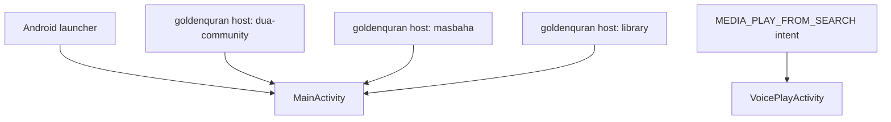

# Navigation Analysis

## Directly observed entry points

The manifest marks MainActivity as the launcher and lists the three deep-link hosts. VoicePlayActivity handles media-search requests. The diagram does not show which exact screen each host opens. (Evidence: `ev_26731ad05568d33e2d46d39425c3f6e21343e27d1ff95f7a0a5fb3bba7874ebf`, `ev_24b65ad3b0aa13e4630a7dfd206de7d2d9c4725b60caad9c37b1c15d334ab9f5`.)

## Candidate screens; route not known

The saved static evidence suggests Quran index/reader, search, audio library/player, bookmarks/notes, prayer time/alarm, athkar/duas, qibla, Khetma, Tasmee, hadith, books/library, live sessions, settings, and statistics areas. These candidates are based on class names and default strings. No edge between them is established. (Evidence: `ev_e1da8b1964770471afaf2078706f7ab6c5392c4e03696fa13416257d25f9ac16`, `ev_05c1f6c2ab3547ccce70c095559a6ad9ec9054f4f4217b7b273a5981faa12128`, `ev_68e06b198c904e77a5ba7ca123f5bad0926a019a2273044dcfcbc0b3617e5274`, `ev_65c3b2089d5998b75b20f115d94412b2f641834090f4cc03f867c6b1cbbc762d`, `ev_61673d9c6428891a4d336fb7206fb0ad39da0fb678bf1c43fa858539dfd026ef`, `ev_b97caf2a9f49d85f6ce467f57f483d268d10b9b3fe7d137bfb270099830bf805`, `ev_32944f8a6a36bf3f3eb20651131c7365b09f929052a59d57731ec287712a12f8`, `ev_5759bc1ed62ad5ea63e8dc5ecc327a048c3dfc94bd86ab592c25389371e3bb83`, `ev_db6aff248d905d610f5e67810ae753c054ff2130db7ff4538e40b132d1a7ee1b`, `ev_24b65ad3b0aa13e4630a7dfd206de7d2d9c4725b60caad9c37b1c15d334ab9f5`.)

| Candidate area | Why it is listed | Route confidence |
|---|---|---|
| Quran reader and index | Quran strings and content models | Candidate only |
| Search | SearchObject/result types and search labels | Candidate only |
| Audio library/player | Media3 service, AudioFragment and audio models | Candidate only |
| Prayer, alarms, widgets | Manifest services, receivers, widget providers | Components observed; screen path unknown |
| Athkar/duas, masbaha, Khetma, Tasmee | Named strings and feature models | Candidate only |
| Hadith and library | Hadith/book strings and LibraryReaderFragment | Candidate only |
| Live sessions/calls | Strings and manifest components | Candidate only |
| Settings/statistics | Local model names | Candidate only |

## Unknown navigation details

The actual home screen, tabs, menus, transitions, back behavior, dialog routes, and deep-link destinations are not established. The archive has no `res/menu` files, but that absence alone does not prove there is no menu built in code. Screen and navigation paths remain open under `unk_8f043049b1fb4680`. (Evidence: `ev_a515a1161c2ab139e888b0749cb24fb0bceef12319a40a2c2fecf7e0ac5e5708`, `ev_24b65ad3b0aa13e4630a7dfd206de7d2d9c4725b60caad9c37b1c15d334ab9f5`; unknown `unk_8f043049b1fb4680`.)
